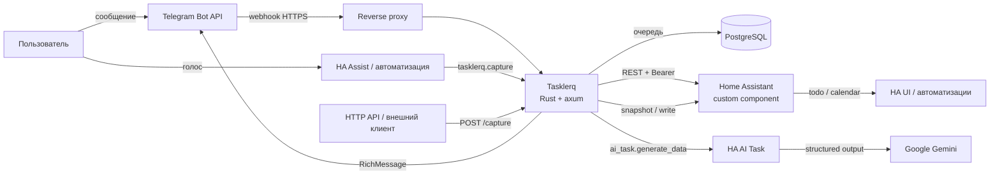

# Tasklerq

**Семейные задачи и покупки — в Telegram, Home Assistant и календаре.**

Tasklerq — self-hosted сервис на Rust, который объединяет задачи, списки
покупок и домашние автоматизации. Добавляйте дела обычной фразой в Telegram
или голосом через Home Assistant, подтверждайте разобранный черновик и смотрите
общий календарь всей семьёй — в том числе через нативные сущности Home
Assistant. Бот при этом не обязателен: задачи можно создавать автоматизацией
или прямым HTTP-запросом.

> **Статус:** в разработке. Группа 1 (инфраструктура репозитория)
> реализована; актуальный прогресс — в
> [`openspec/changes/0001-foundation/tasks.md`](openspec/changes/0001-foundation/tasks.md).

## Возможности MVP

- **Telegram RichMessage UI.** Кнопки внутри сообщения, редактирование экранов,
  навигация без спама, карточки задач и списков.
- **Задачи.** Срок (дата или дата и время), приоритет, теги, подзадачи,
  исполнитель, поиск, повторения.
- **Покупки.** Количество и единицы, отметка «куплено», очистка выполненных,
  несколько списков и чек-листов.
- **Календарь.** Задачи со сроком, вседневные и со временем, повторяющиеся
  вхождения.
- **Home Assistant.** Тонкий custom component: `todo`-сущность на каждый список
  и read-only `calendar` для задач со сроком.
- **LLM-capture.** Свободный текст → структурированный черновик через
  `ai_task.generate_data` Home Assistant (Google Gemini). LLM только разбирает;
  в Telegram данные применяются после подтверждения.
- **Capture без бота.** Голос через HA Assist, автоматизации и HTTP API:
  `POST /api/v1/capture`, сервис `tasklerq.capture`, режим `auto` с
  идемпотентностью, fallback и отменой. Telegram не требуется.
- **Семья.** Один household, роли owner/member, приглашения по deep link, общие
  списки, назначение задач.
- **Напоминания.** Сроки, утренняя сводка, назначения, тихие часы, snooze.
- **Надёжность.** Webhook-очередь в PostgreSQL, идемпотентность, outbox,
  мягкое удаление, backup/restore.

## Архитектура



Подробнее: [`docs/architecture.md`](docs/architecture.md).

## Технологии

| Слой | Выбор |
| --- | --- |
| Язык сервиса | Rust (edition 2024) |
| HTTP | axum + tower + tokio |
| БД | PostgreSQL 18 (`postgres:18-alpine`), sqlx |
| Telegram | webhook + собственный RichMessage-адаптер, типы `teloxide-core` |
| LLM | Home Assistant `ai_task.generate_data`, AI Task `ai_task.google_ai_task_2`, Google Gemini |
| HA-интеграция | Python custom component, `DataUpdateCoordinator` |
| Развёртывание | Docker Compose на Synology NAS, PostgreSQL 18 в сети `shared-db`, Synology Reverse Proxy |
| Наблюдаемость | `tracing` JSON, health/readiness, метрики |

## Планируемая структура репозитория

```text
tasklerq/
├── Cargo.toml
├── src/
│   ├── main.rs
│   ├── config/
│   │   ├── mod.rs
│   │   ├── env_source.rs
│   │   └── tests.rs
│   ├── http/
│   ├── auth/
│   ├── telegram/
│   ├── domain/
│   ├── capture/
│   ├── home_assistant/
│   ├── storage/
│   ├── jobs/
│   └── admin/
├── migrations/
├── custom_components/tasklerq/
├── tests/
├── docs/
├── openspec/
├── docker-compose.yml
├── Dockerfile
└── README.md
```

## Документация

| Документ | О чём |
| --- | --- |
| [`docs/architecture.md`](docs/architecture.md) | Компоненты, потоки данных, API, очереди, развёртывание. |
| [`docs/domain-model.md`](docs/domain-model.md) | Таблицы, инварианты, состояния, повторения, timezone. |
| [`docs/telegram-ux.md`](docs/telegram-ux.md) | Экраны, RichMessage, callback-токены, тексты. |
| [`docs/llm-capture.md`](docs/llm-capture.md) | Промпт, схема, валидация, подтверждение, деградация. |
| [`docs/home-assistant.md`](docs/home-assistant.md) | Установка компонента, сущности, Gemini, ограничения. |
| [`docs/deployment.md`](docs/deployment.md) | Docker, PostgreSQL, TLS, webhook, backup, runbooks. |
| [`docs/roadmap.md`](docs/roadmap.md) | Этапы, backlog, метрики, риски. |

Спецификации поведения: [`openspec/changes/0001-foundation/specs/`](openspec/changes/0001-foundation/specs/).
Контекст проекта: [`openspec/project.md`](openspec/project.md).

## Быстрый старт (после реализации)

```bash
# 1. Скопировать пример конфигурации
cp .env.example .env
$EDITOR .env

# 2. Поднять PostgreSQL для разработки
docker compose up -d postgres

# 3. Применить миграции
make migrate

# 4. Запустить сервис локально в режиме polling
TELEGRAM_MODE=polling make dev

# 5. Открыть @tasklerqbot в Telegram и отправить /start

# 6. Создать токен для внешнего capture
tasklerq admin token create --name "Dev capture" --scopes capture:write

# 7. Проверить capture без бота
curl -X POST http://127.0.0.1:8080/api/v1/capture \
  -H "Authorization: Bearer $TASKLERQ_TOKEN" \
  -H "Content-Type: application/json" \
  -d '{"text":"купить молоко","source":"api","mode":"auto","hint":"shopping"}'
```

Headless-режим без Telegram: `TELEGRAM_MODE=disabled` — HTTP API, HA-компонент
и внешний capture продолжают работать.

Production-развёртывание — через webhook и HTTPS; см.
[`docs/deployment.md`](docs/deployment.md).

## Вне рамок MVP

- Веб-интерфейс и мобильное приложение.
- CalDAV/ICS и синхронизация с телефонным календарём.
- Голосовые сообщения в Telegram и собственное распознавание речи; голосовой
  capture через HA Assist входит в MVP.
- Групповые чаты.
- Несколько household на пользователя и частные списки.
- Магазины, цены, штрихкоды, рецепты.
- Сложные повторения с исключениями.
- HA add-on/ingress, OAuth, публичный API.

## Безопасность

- Секрет Telegram webhook проверяется за постоянное время.
- API-токены хранятся только в виде хеша, с областями действия и отзывом.
- Внешний capture требует `capture:write`, ограничен по телу, длине текста и
  частоте; повтор с `Idempotency-Key` не создаёт дубликаты.
- Каждый ресурс ограничен household; чужие ресурсы возвращают `404`.
- Пользовательский текст экранируется; SQL — только параметризованный.
- LLM не имеет доступа к инструментам и базе; результат валидируется и
  подтверждается.
- Текст сообщений не попадает в логи; секреты — только в env/secret files.

## Лицензия

Лицензия будет выбрана до первого публичного релиза. До этого проект
распространяется как частный self-hosted сервис.
