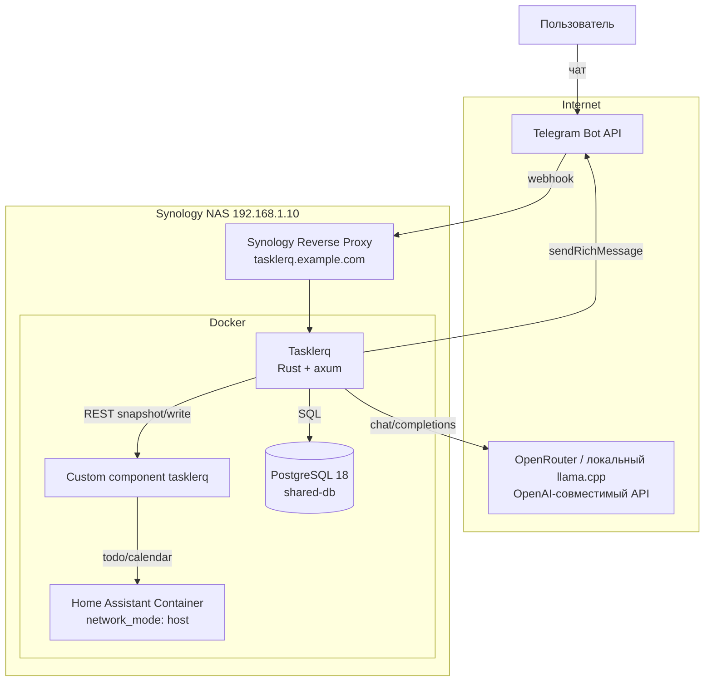
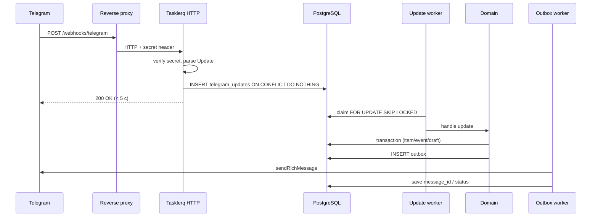
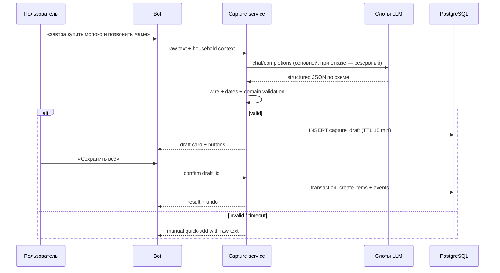
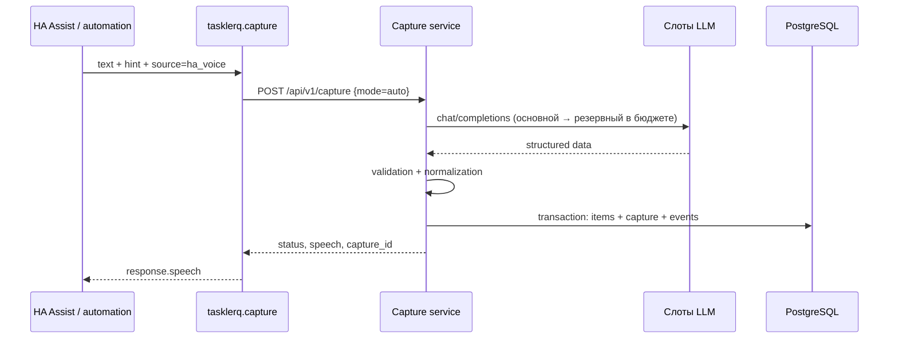
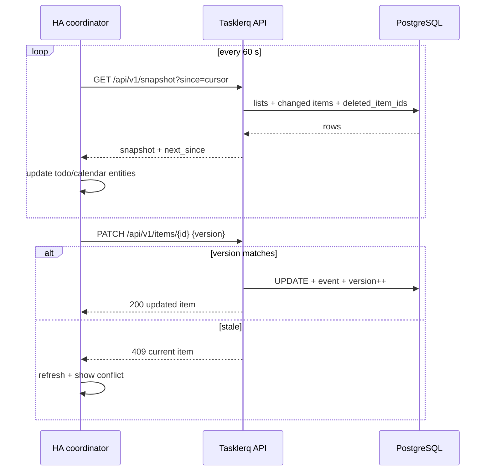
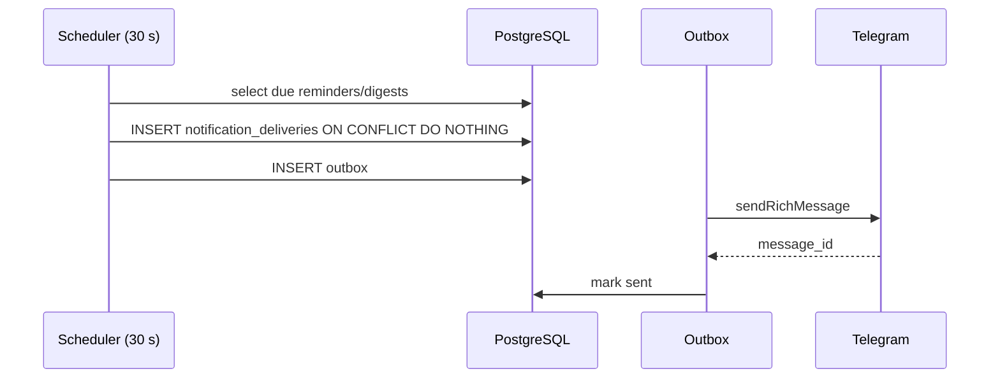
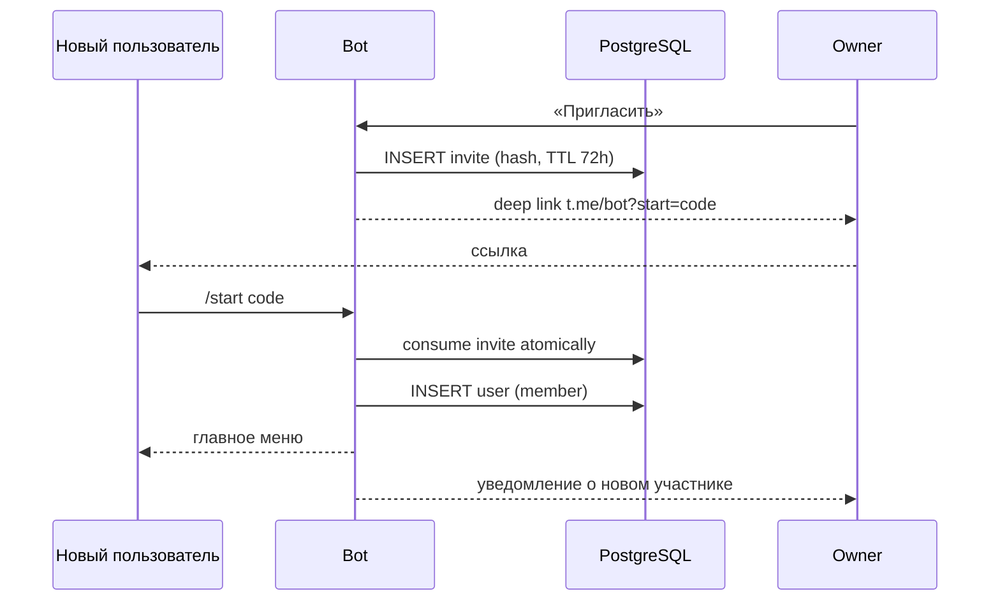

# Архитектура Tasklerq

## 1. Контекст

Tasklerq — семейный сервис, который работает на собственном сервере и
объединяет четыре интерфейса:

- **Telegram** — основной способ добавить, посмотреть и завершить задачу.
- **Home Assistant** — нативные сущности `todo` и `calendar` для дашбордов,
  автоматизаций и голосового capture через Assist.
- **HTTP API** — внешний capture от автоматизаций и других клиентов, в том
  числе без работающего бота.
- **Календарь** — задачи со сроком, включая повторяющиеся вхождения.

Сервис не является SaaS: по умолчанию один экземпляр обслуживает один household
(семью), режим `TENANCY_MODE=multi` допускает несколько. Данные хранятся в
PostgreSQL, который уже есть на сервере пользователя.
LLM-разбор выполняет сам Tasklerq: текст уходит по OpenAI-совместимому API в
основной и необязательный резервный слот (например, Claude Haiku 5.5 через
OpenRouter или локальный llama.cpp). Home Assistant в разборе не участвует:
он передаёт текст голосовой команды и получает готовый `speech`. Задачу можно создать из Telegram
или без него — голосом, автоматизацией или прямым HTTP-запросом.

### Ограничения

| Ограничение | Следствие |
| --- | --- |
| Rust | Один бинарник, строгая типизация, tokio-воркеры. |
| PostgreSQL | Очереди и состояние — в БД, без Redis/Kafka. |
| Telegram webhook | Нужен публичный HTTPS и reverse proxy. |
| RichMessage — молодой API | Собственный адаптер и contract-тесты. |
| HA Container | Custom component, без add-on/ingress. |
| LLM через OpenAI-совместимый API | Основной и резервный слоты; Home Assistant AI Task не используется. |
| Capture без Telegram | Отдельный API, HA-сервис и auto-режим; бот не обязателен. |
| Семейный масштаб | Монолит, один экземпляр, без шардирования. |

## 2. Компоненты



| Компонент | Роль | Технологии |
| --- | --- | --- |
| **Tasklerq core** | Домен, API, webhook, очереди, планировщик | Rust, axum, tokio, sqlx |
| **Admin console** | Отдельный listener для оператора инсталляции: вход, мастер, настройки LLM, проверка слота | axum, askama, htmx, `src/admin_console/` |
| **Telegram adapter** | RichMessage, вызовы Bot API | reqwest, teloxide-core types |
| **PostgreSQL** | Source of truth, очередь обновлений, outbox, черновики | PostgreSQL 18 (`postgres:18-alpine`) |
| **HA custom component** | Мост между REST API и сущностями HA | Python, aiohttp, HA integration |
| **LLM slots** | Разбор текста через OpenAI-совместимый API: основной и необязательный резервный эндпоинты; источник — окружение или консоль, действует [снимок](#снимок-действующей-конфигурации-llm) | `src/llm/`, reqwest, JSON Schema `response_format` |
| **Reverse proxy** | TLS, публикация webhook | Synology DSM Reverse Proxy |

## 3. Потоки данных

### 3.1 Входящее сообщение Telegram



Ключевые свойства:

- webhook отвечает быстро, потому что обработка идёт в воркере;
- `update_id` — первичный ключ, повторная доставка не создаёт дубль;
- воркер может безопасно работать в нескольких экземплярах благодаря
  `SKIP LOCKED`;
- исходящие сообщения не теряются при сбое Telegram.

### 3.2 LLM-capture



LLM не пишет в базу и не вызывает инструменты. В Telegram валидный ответ не
применяется без подтверждения. Внешний capture в режиме `auto` применяет его
сразу, но только после серверной валидации и в одной транзакции.

Внешний capture:



Внешний capture не создаёт запись в `outbox` и не требует Telegram. При
недоступности LLM `auto` создаёт одну позицию из исходного текста, если
включён `CAPTURE_VOICE_FALLBACK_RAW` (по умолчанию `true`); иначе возвращает
`503`.

#### Снимок действующей конфигурации LLM

Действующие параметры LLM живут в одном снимке на процесс — `LlmHandle`
(`src/llm/snapshot.rs`): `ArcSwap<LlmSnapshot>` и монотонная версия.
`LlmSnapshot` содержит версию, разрешённые настройки (`EffectiveLlm`: слоты,
флаг, таймаут соединения, квота и источник каждого поля), готовую цепочку
`Option<Arc<Chain>>` и суточную квоту. Цепочки нет, если разбор выключен,
основной слот не настроен или конфигурация невалидна; тогда в журнал уходит код
ошибки без адреса и токена.

Снимок читают все потребители разбора, каждый — в начале своей работы:

- HTTP capture (`CaptureState`) берёт снимок один раз на запрос и до конца
  использует его цепочку и квоту;
- `CaptureWorker` берёт снимок один раз на задание;
- бот при обработке обновления решает по снимку, ставить ли задание разбора;
- `LlmSlotHealth` для readiness берёт из снимка слоты и их отпечатки и
  сбрасывает кеш статусов при смене версии.

Поэтому начатый разбор завершается с прежней цепочкой и прежней квотой, а
следующий видит новую.

При старте снимок собирает `app::build_llm_handle`: `settings::read_effective_llm`
читает таблицу `settings` и складывает её с окружением и умолчаниями
(`settings::effective_llm`). Сбой чтения базы не роняет сервис: снимок
собирается только из окружения и умолчаний, а в журнал уходит предупреждение без
значений.

Замена снимка — `LlmSettings::apply` (`src/llm/settings.rs`):

1. захватывается мьютекс сохранения;
2. в одной транзакции пишутся изменения, читаются настройки инсталляции,
   собираются `EffectiveLlm`, новая цепочка (`LlmSnapshot::rebuild`) и снимок;
3. только после этого выполняется commit;
4. затем `LlmHandle::store` присваивает следующую версию и публикует снимок.

Ошибка разбора значений или сборки цепочки откатывает транзакцию: настройки и
снимок остаются прежними. Мьютекс нужен потому, что присвоение версии и
публикация — два шага: без него более раннее сохранение могло бы опубликовать
свою версию последней.

Предохранители слотов живут в цепочке. При сборке новой цепочки слот, отпечаток
которого не изменился, получает предохранитель прежней цепочки (тот же
`Arc<CircuitBreaker>`), а изменённый или новый начинает с замкнутым. Так смена
одной квоты не сбрасывает разомкнутый предохранитель недоступного слота, а смена
модели начинает проверку заново. Отпечаток считается теми же частями, что у
проверки слота (`src/capture/slot_check.rs::fingerprint`):

| Входит в отпечаток | Не входит |
| --- | --- |
| вид слота (`openai`) | токен |
| модель | суточная квота |
| хост адреса (порт включается, только если задан явно; без схемы, пути, учётных данных и query) | схема и путь адреса, `extra_json` |
| таймаут запроса слота | таймаут установки соединения |
| хеш контракта промпта и схемы ответа | источник значения (окружение или база) |
| хеш smoke-набора | |
| стандарт сравнения названий | |

Смена только полей из правой колонки сохраняет разомкнутый предохранитель.
Стандарт сравнения названий входит в отпечаток проверки, но при переносе
предохранителя `LlmSnapshot::rebuild` считает его `strict` и для старой, и для
новой цепочки, поэтому на равенство отпечатков при замене настроек он не влияет.

`CaptureWorker` запускается вместе с Telegram-рантаймом всегда, даже когда
слотов нет: задание, поставленное при одной конфигурации, может обработаться уже
при другой. Если в снимке на момент обработки нет цепочки, задание завершается
окончательно с кодом `llm_disabled` (`retryable = false`), и пользователь
получает ручной редактор с исходным текстом — так же, как при исчерпанной квоте
или разомкнутых предохранителях. Очередь описана в
[`llm-capture.md`](llm-capture.md#очередь-разбора-в-telegram).

### 3.3 Home Assistant snapshot и запись



Polling выбран из-за простоты и надёжности. Запись из HA инициирует
внеочередной refresh, чтобы интерфейс обновился быстрее.

### 3.4 Напоминания



Уникальный ключ `(user_id, item_id, occurrence_key, kind)` защищает от дублей
после перезапуска. Тихие часы сдвигают доставку, но не теряют её.

### 3.5 Онбординг и приглашение



Первый контакт зависит от `TENANCY_MODE`. В `single` на пустой инсталляции
онбординг проходит `BOOTSTRAP_OWNER_TELEGRAM_ID`, если он задан, иначе —
первый написавший боту; при существующем household с владельцем новый
пользователь получает просьбу взять приглашение, household без владельца
показывает команду администратора (чужой `BOOTSTRAP_OWNER_TELEGRAM_ID` видит
нейтральный экран «Пространство ещё не настроено»), а при нескольких
household — экран «Нужен администратор». В `multi` онбординг доступен каждому
новому пользователю.

### 3.6. Фоновые задачи

Шаг «переход повторяющихся событий» вынесен из планировщика в отдельный
`DomainTicker` (`src/jobs/domain.rs`). Он работает всегда, как retention, и
переводит прошедшие серии событий на первое непрошедшее вхождение без Telegram:
сценарий «только Home Assistant» тоже должен продвигать календарь. Остальные
шаги `Scheduler` (отмена устаревших доставок, планирование напоминаний, сводок и
сводных сообщений) остаются в Telegram-рантайме: без бота доставлять некому.
`RetentionWorker` и `DomainTicker` запускаются в `app::build_application`
независимо от режима Telegram.

### 3.7. Поколения Telegram и переключение

Telegram-часть живёт поколениями. `TelegramSupervisor`
(`src/telegram/runtime.rs`) владеет текущим поколением: клиентом Bot API,
набором задач и собственным `watch`-каналом остановки, производным от
процессного shutdown. Приём webhook лежит в `IngressSlot`
(`ArcSwapOption<Ingress>` в `AppState`), поэтому смена поколения не пересобирает
роутер. `IngressSlot` же хранит живой признак «поколение есть»: он нужен
readiness отдельно от приёма, потому что в polling приёма нет.

В поколение входят задачи, которые `start_generation` создаёт через `spawn`:

| Задача | Когда запускается |
| --- | --- |
| `poll` | только в режиме `polling` |
| `UpdateWorker::run` | всегда |
| `CaptureWorker::run` | всегда |
| `Scheduler::run` | всегда |
| `OutboxWorker::run` | всегда |

Вне поколения остаются `DomainTicker` и `RetentionWorker` (процессные задачи
`app::build_application`), HTTP-маршрут capture и снимок LLM. Поэтому переход
повторяющихся событий и чистка базы работают без бота, `CaptureWorker` читает
тот же снимок, а `POST /webhooks/telegram` обслуживает роутер, а не задача
поколения; при смене настроек LLM поколение не пересоздаётся.

Переключение запускает консоль: страница «Telegram» (`/admin/telegram`) после
записи настроек вызывает `TelegramSupervisor::reload`; автоматического опроса
`settings` нет. `reload` читает группу Telegram так же, как старт, и
сериализуется мьютексом вместе с первым запуском и остановкой по shutdown
процесса.

Порядок переключения:

1. Приём снимается (`IngressSlot::begin_switch`): `POST /webhooks/telegram`
   отвечает `503` с `Retry-After: 5`, и Telegram повторяет доставку. Если
   поколения нет и режим выключен, ответ остаётся `404`.
2. Кооперативная остановка: `poll`, `UpdateWorker`, `CaptureWorker`,
   `Scheduler` и `OutboxWorker` проверяют сигнал между итерациями.
   `OutboxWorker` не прерывает начатый `deliver_one`: вызов Bot API, запись
   `message_id` и commit завершаются, поэтому на штатном пути сообщение не
   уходит дважды. Супервизор ждёт завершения задач до 30 с.
3. Если поколение не остановилось за 30 с, супервизор пишет ошибку в журнал и
   делает `abort`. Это аварийный путь: прерванная отправка может повториться в
   новом поколении (допустим один повтор сообщения). Обработка обновления идёт
   в транзакции, захватившей строку `telegram_updates` через
   `FOR UPDATE SKIP LOCKED`; при `abort` транзакция откатывается, строка остаётся
   `pending`, и её берёт новое поколение. Задание разбора (`capture_jobs`)
   захватывается как `running` с `locked_until`; после `abort` оно остаётся
   `running` до истечения аренды `LEASE` (60 с), после чего `claim_next` берёт
   его снова, а при исчерпании попыток переводит в `dead`.
4. Запускается новое поколение: в webhook — `setWebhook`, в polling —
   `deleteWebhook` и `poll`; новый `Ingress` кладётся в слот. Переключение в
   `disabled` поколения не создаёт.
5. Мьютекс отпускается, признак переключения снимается на любом выходе, включая
   ошибку сборки клиента.

Polling: висящий `getUpdates` прежнего поколения отменяется вместе с задачей.
Если Telegram всё же ответит новому поколению `409 Conflict`, `poll` не
завершается, а повторяет запрос через 3 с.

Readiness проверяет лаг очереди обновлений только при живом поколении: старт
выключенным и включение из консоли включают проверку, а `reload` в выключенный
режим при непустой очереди её снимает. Пока идёт переключение
(`begin_switch`…`end_switch`), лаг очереди не проверяется. Метрика
`telegram_queue_lag_seconds` считается всегда.

Graceful shutdown процесса переводит процессный `watch` в `true`. Задача
`TelegramSupervisor::run` встаёт в очередь мьютекса и останавливает текущее
поколение, в том числе запущенное после старта. `serve` после остановки
HTTP-сервера ждёт задачи `Application::workers`: супервизор, retention и
доменный тикер. Каждая задача ждётся не дольше 10 с, а не 30 с
`STOP_TIMEOUT` переключения. Если задача не уложилась, процесс выходит, и
аварийный `abort` поколения может не дойти: сообщение о незавершённой отправке
останется в журнале. Строка `outbox` захвачена транзакцией `deliver_one`; без
`abort` транзакция откатывается, строка остаётся `pending` и будет отправлена
заново при следующем запуске.

### 3.8. Консоль администратора

Консоль — второй HTTP-listener на `ADMIN_BIND_ADDR` (по умолчанию
`0.0.0.0:8081`), а не набор путей публичного роутера. Она собрана в
`src/admin_console/`: `router.rs` (маршруты и слой `Origin`), `session.rs`
(cookie и проверка сессии), `setup.rs`, `login.rs`, `change.rs`, `recovery.rs`
(сценарии входа и пароля), `codes.rs` (одноразовые коды), `wizard.rs` (шаги
мастера), `checks.rs` (ход проверки слота), `telegram.rs` (подключение бота и
переключение поколения через супервизор) и `pages.rs` (HTML-шаблоны askama).
Сессии и коды хранятся в PostgreSQL, секреты настроек — в `settings` под ключом
из окружения. Консоль переиспользует административные операции
`src/admin/mod.rs` и работает от системного актора.

## 4. Модули Rust

```text
src/
├── main.rs              # CLI: serve, migrate, seed, admin, healthcheck, capture-eval
├── lib.rs
├── app.rs               # сборка приложения и фоновых задач
├── config/              # env, валидация, секреты
│   ├── mod.rs
│   └── env_source.rs
├── http/
│   ├── router.rs        # /api/v1, /webhooks, /health, /metrics
│   ├── server.rs        # запуск axum и graceful shutdown
│   ├── middleware.rs    # request_id и журналирование
│   ├── error.rs         # единый формат ошибок
│   ├── health.rs        # live/readiness
│   ├── metrics.rs       # Prometheus exposition
│   └── api/             # household, lists, items, capture(s), search,
│                        # calendar, snapshot, dto
├── auth/
│   ├── tokens.rs        # API-токены: выпуск, отзыв, scopes, хеширование
│   ├── secrets.rs       # случайные секреты (токены, коды приглашений)
│   └── access.rs        # роли owner/member, системные акторы
├── telegram/
│   ├── api.rs           # trait TelegramApi + HTTP-клиент
│   ├── rich.rs          # RichMessage DTO и рендерер
│   ├── webhook.rs       # приём и постановка в очередь
│   ├── queue.rs         # очередь telegram_updates
│   ├── worker.rs        # обработка updates
│   ├── capture_worker.rs # очередь разбора текста
│   ├── callbacks.rs     # токены и маршрутизация
│   ├── views.rs         # экраны, формы и состояние чата
│   ├── outbox.rs        # исходящие сообщения и удаление
│   ├── runtime.rs       # супервизор поколений Telegram
│   └── bot/             # экраны, формы, онбординг, уведомления
├── domain/
│   ├── models.rs        # типы домена и перечисления
│   ├── identity.rs      # приглашения, аудит, уведомления о составе
│   ├── first_contact.rs # классификатор первого контакта
│   ├── recurrence.rs    # движок повторений
│   ├── calendar.rs      # развёртка календаря
│   ├── search.rs        # фильтры и курсор поиска
│   ├── settings.rs      # профиль и настройки уведомлений
│   └── validation.rs    # доменная валидация полей
├── capture/
│   ├── draft.rs         # черновики и применение capture
│   ├── schema.rs        # RawItem, ParseError и лимиты разбора
│   ├── wire.rs          # разбор ответа v4: три формы, уточнения
│   ├── contract.rs      # таблица полей и JSON Schema ответа
│   ├── prompt.rs        # версионированный промпт и сборка запроса
│   ├── dates.rs         # выражения дат → календарные значения
│   ├── convert.rs       # элемент v4 → RawItem
│   ├── validate.rs      # доменная валидация
│   ├── llm.rs           # разбор через цепочку слотов
│   ├── slot_check.rs    # прогон smoke-набора и отпечаток слота
│   ├── slot_status.rs   # статус проверки слотов для readiness и метрики
│   ├── context.rs       # контекст household для разбора
│   └── breaker.rs       # предохранитель вызовов LLM
├── llm/
│   ├── mod.rs           # ChatBackend и OpenAI-совместимый клиент
│   ├── chain.rs         # Slot, Chain, бюджет, резервный слот
│   ├── snapshot.rs      # LlmHandle, LlmSnapshot, перенос предохранителей
│   └── settings.rs      # применение настроек: транзакция → сборка → store
├── settings/
│   ├── mod.rs           # ключи настроек, effective_llm, чтение и запись
│   └── crypto.rs        # XChaCha20-Poly1305 и контекст строки
├── admin_console/
│   ├── router.rs        # отдельный listener, маршруты, сверка Origin
│   ├── session.rs       # cookie tlq_admin и проверка сессии
│   ├── codes.rs         # setup- и recovery-коды, их хеши и сроки
│   ├── wizard.rs        # шаг мастера и пропуски
│   └── pages.rs         # страницы, формы и шаблоны askama
├── storage/
│   ├── repositories/    # sqlx-репозитории
│   ├── migrations.rs
│   ├── db.rs
│   └── seed.rs
├── jobs/
│   ├── scheduler.rs     # тик 30 с в Telegram-рантайме
│   ├── domain.rs        # DomainTicker: переход повторяющихся событий всегда
│   ├── delivery.rs      # доставка уведомлений
│   ├── digest.rs        # утренняя сводка
│   ├── batch.rs         # сводное сообщение отложенных
│   ├── assignment.rs    # уведомления о назначении
│   ├── quiet.rs         # тихие часы
│   └── retention.rs     # retention и purge
└── admin/
    └── mod.rs           # операции CLI
```

Границы модулей:

- `http` не содержит бизнес-логики, только разбор запросов и вызовы сервисов.
- `domain` не знает про Telegram и HA; он работает с household, списками и
  элементами.
- `telegram` зависит от `domain` и `capture`, но не наоборот.
- `capture` зависит от `llm` и `domain`.
- `llm` — транспорт, цепочка слотов и снимок действующей конфигурации; он не
  знает про Telegram и домен. Сохранение настроек (`llm/settings.rs`) —
  единственное место, где `llm` работает с базой.
- `settings` — таблица `settings`, перечень ключей, шифрование секретов и сборка
  `EffectiveLlm`; знает про `config` и `storage`, не знает про Telegram.
- `storage` — конкретные sqlx-репозитории и миграции, без trait-портов;
  домен не зависит от Telegram и Home Assistant.

## 5. Согласованность и идемпотентность

| Операция | Механизм |
| --- | --- |
| Повтор webhook | `telegram_updates.update_id` PK, `ON CONFLICT DO NOTHING`. |
| Повтор callback | Одноразовый токен, атомарное потребление. |
| Повтор подтверждения черновика | `capture_drafts.status = applied`, уникальный `draft_id`. |
| Повтор завершения задачи | Проверка статуса, событие только при переходе. |
| Повтор напоминания | Уникальный `notification_deliveries`. |
| Повтор отправки | `outbox.message_id`, идемпотентный edit. |
| Конфликт редактирования | `version` + `409`. |
| Удаление | Soft delete; отмена удаления через undo в течение 10 минут. Отдельного restore нет, через 30 дней retention удаляет запись физически. |

Транзакции обязательны для:

- применения черновика (все элементы);
- завершения повторяющейся задачи (событие + новый срок);
- очистки выполненных;
- удаления участника (назначения + приглашения + доступ);
- подтверждения приглашения (использование + создание пользователя).

## 6. Время и повторения

- `due_at` — `timestamptz` в UTC.
- `due_date` — `date` без времени.
- `recurrence_timezone` — IANA; по умолчанию timezone household.
- Повторение считается по локальному настенному времени: 09:00 остаётся 09:00
  при смене DST.
- Якорь серии (`recurrence_anchor_date`) не меняется при завершении; это
  предотвращает дрейф месячных и годовых серий.
- 31-е число (`month_rule = anchor_day`): месяцы без 31-го пропускаются.
- Последний день месяца (`month_rule = last_day`): 28/29/30/31 без пропусков.
- 29 февраля: невисокосные годы пропускаются.
- Развёртка календаря: максимум 366 дней и 1000 вхождений на запрос.
- Следующее вхождение — первое строго позже и текущего срока, и момента
  завершения.
- Завершение серии после `until` переводит задачу в `done` без следующего срока.

Подробные примеры — в [`domain-model.md`](domain-model.md#7-повторения).

## 7. API

Базовый путь: `/api/v1` (health-эндпоинты и `/metrics` — вне него).
Аутентификация —
`Authorization: Bearer <token>`. Все ответы — JSON; время — RFC 3339;
идентификаторы — UUID.

| Метод | Путь | Назначение |
| --- | --- | --- |
| `GET` | `/health/live` | Процесс жив. |
| `GET` | `/health/ready` | БД, миграции, очередь. |
| `GET` | `/api/v1/household` | Household, участники, настройки. |
| `GET` | `/api/v1/lists` | Списки. |
| `POST` | `/api/v1/lists` | Создать список. |
| `PATCH` | `/api/v1/lists/{id}` | Переименовать/архивировать. |
| `DELETE` | `/api/v1/lists/{id}` | Мягко удалить. |
| `GET` | `/api/v1/lists/{id}/items` | Позиции списка. |
| `POST` | `/api/v1/lists/{id}/items` | Создать задачу/позицию. |
| `GET` | `/api/v1/items/{id}` | Карточка. |
| `PATCH` | `/api/v1/items/{id}` | Изменить (нужна `version`; без изменений — `200` без роста `version`). |
| `DELETE` | `/api/v1/items/{id}` | Мягко удалить. |
| `POST` | `/api/v1/items/{id}/complete` | Завершить. |
| `POST` | `/api/v1/items/{id}/reopen` | Открыть. |
| `POST` | `/api/v1/items/{id}/undo` | Отменить последнее действие. |
| `POST` | `/api/v1/capture` | Внешний capture без Telegram (`auto`/`draft`). |
| `POST` | `/api/v1/captures/{id}/confirm` | Подтвердить внешний черновик. |
| `POST` | `/api/v1/captures/{id}/cancel` | Отменить внешний черновик. |
| `POST` | `/api/v1/captures/{id}/undo` | Отменить применённый capture. |
| `POST` | `/api/v1/captures/undo-last` | Отменить последний голосовой capture. |
| `GET` | `/api/v1/search` | Поиск. |
| `GET` | `/api/v1/calendar` | Вхождения за интервал. |
| `GET` | `/api/v1/snapshot` | Инкрементальный снапшот для HA. |

Точный контракт для клиента Home Assistant — поля, коды и семантика
курсора: [`ha-api.md`](ha-api.md).

Ошибки:

```json
{
  "error": {
    "code": "conflict",
    "message": "Task was modified",
    "details": {"current_version": 4},
    "request_id": "01J..."
  }
}
```

Коды: `validation_error` (422), `unauthorized` (401), `forbidden` (403),
`not_found` (404), `conflict` (409), `gone` (410), `rate_limited` (429),
`internal_error` (500), `service_unavailable` (503),
`payload_too_large` (413), `unsupported_media_type` (415),
`method_not_allowed` (405). Сообщения API — английские для разработчиков; бот
и HA переводят их на русский. Отказы разбора JSON-тела на маршрутах списков
и позиций приходят от axum как текст с `400`/`415`/`422`, без этого конверта;
`POST /capture` всегда отдаёт конверт.

### Snapshot

`GET /api/v1/snapshot?since=<cursor>&calendar_end=<date>`:

```json
{
  "server_time": "2026-11-03T12:00:00Z",
  "next_since": "2026-11-03T11:59:55Z",
  "lists": [],
  "items": [],
  "deleted_item_ids": [],
  "calendar_events": [],
  "calendar_truncated": false
}
```

`since` — курсор из предыдущего ответа. При первом запросе или смене токена
параметр `since` не передаётся (пустая строка — ошибка `422`), и возвращается
полный снапшот. `next_since` — это `server_time` минус 5 секунд перекрытия
(защита от конкурентных коммитов); компонент применяет изменения
идемпотентно по `id`, а `version` использует для записи и проверки конфликтов.

`lists` в снапшоте всегда полный (включая архивные) и не зависит от `since`;
отдельного массива удалённых списков нет — компонент сравнивает набор `id` с
локальным. `deleted_item_ids` приходит только в инкрементальном ответе; при
полной синхронизации удаления определяются отсутствием позиции в `items`.

`calendar_events` возвращаются, только если передан `calendar_end` (не позже
366 дней от сегодня). Календарь в снапшоте вспомогательный: при более чем 1000
вхождений ответ усекается по раннему началу и приходит `calendar_truncated:
true`, а не ошибка, чтобы синхронизация `todo` не зависела от календаря. Полный
горизонт компонент берёт через `GET /api/v1/calendar`.

## 8. Home Assistant component

Компонент поставляется из отдельного репозитория `tasklerq-ha`; ниже —
структура его каталога.

```text
custom_components/tasklerq/
├── __init__.py          # entry setup, coordinator, unload
├── manifest.json        # domain, version, requirements, iot_class
├── config_flow.py       # URL + token, reauth, options
├── api.py               # aiohttp client
├── coordinator.py       # DataUpdateCoordinator + snapshot cursor
├── todo.py              # TodoListEntity per list
├── calendar.py          # CalendarEntity
├── diagnostics.py       # redacted dump
├── services.py          # capture / confirm_capture / cancel_capture / undo_last_capture
├── services.yaml        # описания полей сервисов
├── const.py
├── strings.json
└── translations/ru.json
```

- `todo`-сущность на каждый неархивированный список.
- `calendar.tasklerq` — одна read-only сущность для задач со сроком.
- `unique_id`: `tasklerq:<household_uuid>:<list_uuid>`.
- Дополнительные поля — в атрибуте `tasklerq_items`.
- Сервис `tasklerq.capture` вызывает `POST /api/v1/capture`; для HA Assist
  поставляется пример пользовательских предложений (custom sentences) +
  `intent_script`.
- Polling 60 с, backoff до 5 минут, reauth при 401.
- Запись передаёт `version`; при 409 — refresh и ошибка.

Подробно: [`home-assistant.md`](home-assistant.md).

## 9. Развёртывание

```text
Telegram ──443──▶ Synology Reverse Proxy ──▶ 127.0.0.1:18080 tasklerq
                                                    │
                    ┌───────────────────────────────┼──────────────────────┐
                    ▼                               ▼                      ▼
              PostgreSQL 18                  HA Container             api.telegram.org
              shared-db:5432                 network_mode: host
                    ▲                               │
                    └──────── SQL ─────────────────┤
                                                    ▼
                                      LLM slots → OpenRouter / llama.cpp
```

- Tasklerq — bridge-контейнер; host-порт `18080` публикуется только на
  loopback (`8080` занят Zigbee2MQTT).
- HA работает в `network_mode: host`; HA → Tasklerq:
  `http://127.0.0.1:18080`. Слоты LLM Tasklerq берёт из окружения или из
  настроек консоли (действует снимок), а не из Home Assistant; в сеть уходят
  запросы к OpenAI-совместимому API.
- Консоль администратора — второй listener на `ADMIN_BIND_ADDR` (в контейнере
  `0.0.0.0:8081`). Порт не публикуется по умолчанию; при публикации доступен
  только через пароль, для внешнего доступа — HTTPS-прокси с отдельным хостом.
- PostgreSQL — контейнер `postgres:18-alpine`; в dev compose он публикует
  `127.0.0.1:15433`, на NAS живёт в сети `shared-db`. Tasklerq не управляет
  сервером БД.
- TLS завершается Synology Reverse Proxy; webhook доступен только по HTTPS.
- Секреты — env-file 0600 или Docker secrets.
- Миграции — при старте под advisory lock или отдельной командой.
- Backup — ежедневный `pg_dump` (14 дней) + Hyper Backup на внешний диск.

Подробно: [`deployment.md`](deployment.md).

## 10. Безопасность

| Слой | Мера |
| --- | --- |
| Webhook | Секрет, constant-time, 401, лимит тела 1 МБ. |
| API | Bearer-токены, SHA-256 хеш, scopes, revoke. |
| Capture API | `capture:write`, тело 16 КБ, текст до 2000 символов, rate limit, `Idempotency-Key`. |
| Tenant | `household_id` во всех запросах, 404 для чужих. |
| Callback | Одноразовые токены, привязка к user, TTL. |
| Ввод | Валидация, экранирование HTML, параметризованный SQL. |
| LLM | Делимитеры, schema-only, без инструментов, валидация, подтверждение. |
| Секреты | env/secret files, redaction, ротация. |
| Консоль | Отдельный listener, cookie-сессия, точная сверка `Origin`, лимит неудач, аудит. |
| Абьюз | Rate limits, LLM-квота, 429. |
| Приватность | Минимизация, отсутствие текста в логах, retention. |

Подробно: [`security-privacy` spec](../openspec/specs/security-privacy/spec.md).

## 11. Наблюдаемость

- JSON-логи с `request_id`, `update_id`, `route`, `status`, `duration_ms`,
  `error_code`, `version`.
- Метрики: обновления, задержка очереди, outbox, capture по источникам,
  fallback, LLM, HTTP, пул БД.
- `/health/live` — процесс; `/health/ready` — БД, миграции, очередь.
- Предупреждения readiness для LLM и консоли: `llm_unavailable`,
  `llm_slot_unverified:<slot>[:<режим>]`, `multiple_households`,
  `secret_key_missing`, `secret_undecryptable`. Статус слотов и серия
  `llm_slot_verified` пересчитываются по версии снимка на следующем запросе
  readiness, а не в момент сохранения настроек — см.
  [«Снимок действующей конфигурации LLM»](#снимок-действующей-конфигурации-llm).
- События безопасности и консоли — в `audit_events`: входы, отказы, изменения
  настроек без значений; неудачные входы в консоль входят в общий порог отказов
  аутентификации с webhook.
- Алерты: readiness >2 мин, queue lag >5 мин, LLM errors >20%, backup failed,
  отказы аутентификации >50/5 мин (webhook и вход в консоль).

Текст сообщений, токены и имена в логи не попадают.

## 12. Тестирование

| Уровень | Что проверяет |
| --- | --- |
| Unit | Валидация, повторения, timezone/DST, RichMessage, callback-токены. |
| Integration | PostgreSQL через testcontainers, транзакции, очередь, миграции. |
| Contract | Mock Telegram и локальный HTTP-сервер слота LLM; JSON Schema `response_format`, снимок промпта и хеш контракта. |
| Python | Config flow, todo, calendar, diagnostics, конфликты. |
| E2E | Fake Telegram и fake HA в интеграционных тестах; staging-приёмка. |
| LLM eval | ≥30 фраз, точность извлечения ≥90%. |
| Load | 10 пользователей, 10 000 задач, 50 webhook/с. |

## 13. Ключевые решения (ADR)

| # | Решение | Альтернативы | Причина |
| --- | --- | --- | --- |
| 1 | Модульный монолит на Rust | Микросервисы, Python/Node | Семейный масштаб, один деплой, строгая типизация. |
| 2 | PostgreSQL для очередей | Redis, RabbitMQ | Уже есть; меньше инфраструктуры; `SKIP LOCKED`. |
| 3 | Webhook + очередь | Long polling, inline | Требование webhook; устойчивость к таймаутам. |
| 4 | Собственный RichMessage-адаптер | teloxide dispatcher | teloxide не поддерживает RichMessage. |
| 5 | LLM только разбор | LLM с инструментами | Безопасность, контроль, подтверждение. |
| 6 | HA custom component | MQTT, CalDAV, AppDaemon | Нативные `todo`/`calendar`, HA Container. |
| 7 | Polling HA 60 с | Webhook в HA, websocket | Простота, надёжность, достаточная задержка. |
| 8 | Один household по умолчанию (`TENANCY_MODE=single`), `multi` как опция | Мультитенантность по умолчанию | Семейный сценарий, простая авторизация. |
| 9 | Единые `items` | Отдельные tasks/shopping | Общие операции, поиск, события, HA. |
| 10 | UUIDv7 | UUIDv4, bigserial | Сортировка по времени, безопасность в URL. |
| 11 | Снимок настроек LLM с заменой без перезапуска | Перезапуск процесса при смене настроек | Перезапуск обрывает webhook и начатые разборы и зависит от restart policy. Снимок в `ArcSwap` заменяется под мьютексом после commit: следующий разбор видит новые слоты и квоту, начатый — прежние. |

## 14. Границы масштаба

- До ~10 пользователей и ~10 000 активных задач.
- Один экземпляр сервиса; несколько экземпляров допустимы за счёт
  `SKIP LOCKED`, но не обязательны.
- Polling HA создаёт нагрузку O(изменённых элементов) на клиента, а не полный
  дамп.
- Календарь ограничен 366 днями и 1000 вхождениями.
- LLM-квота по умолчанию 200 разборов в сутки на household.

## 15. Открытые вопросы

Среда уже известна: Synology NAS, HA Container `2026.10.4` в
`network_mode: host`, HACS, PostgreSQL 18 в сети `shared-db`, Synology Reverse
Proxy, домен `tasklerq.example.com`, бот `@tasklerq_example_bot`, часовой пояс
`Europe/Moscow`, backup — Hyper Backup на внешний диск.

Осталось уточнить:

- бюджет LLM при квоте 200 разборов в сутки (основной и резервный слот
  выбираются по результатам `capture-eval`; разбор идёт напрямую в
  OpenAI-совместимый API).
