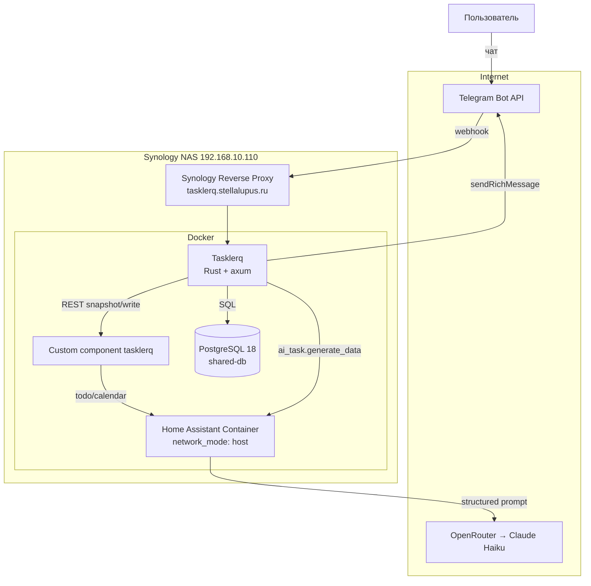
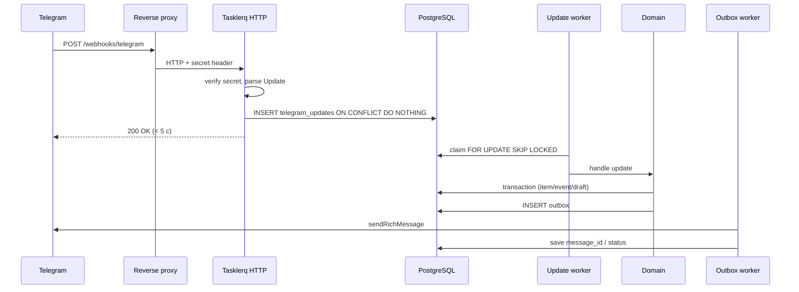
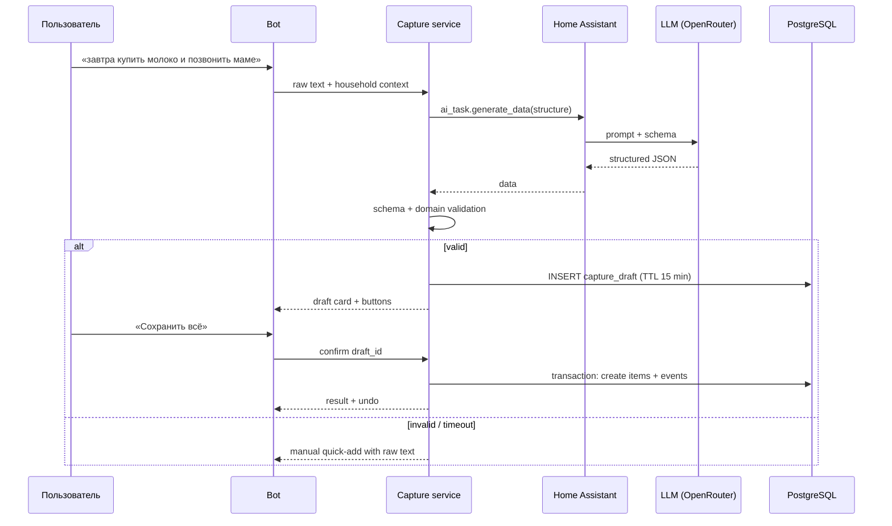
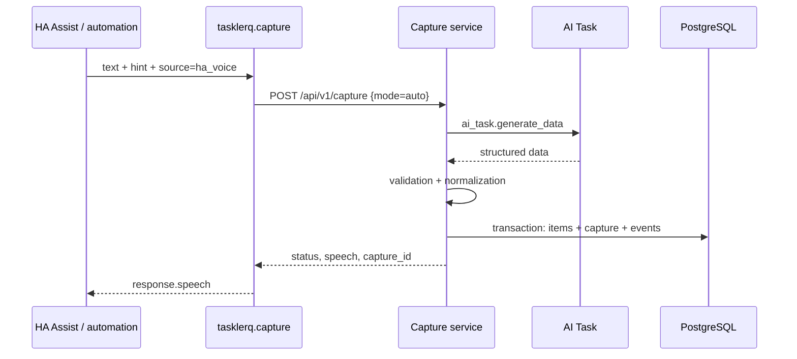
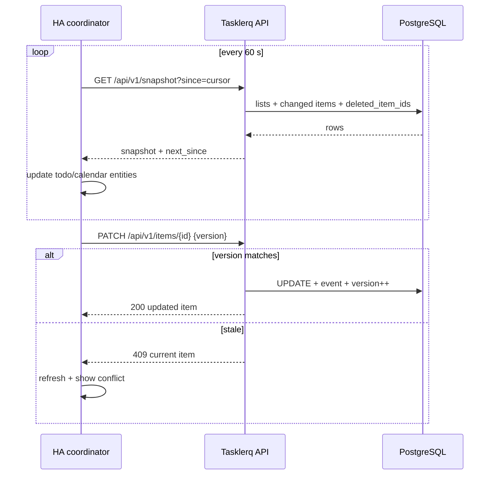
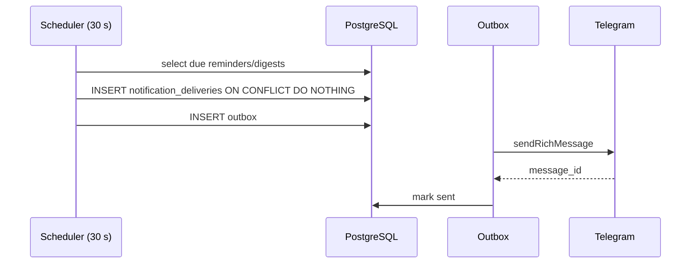
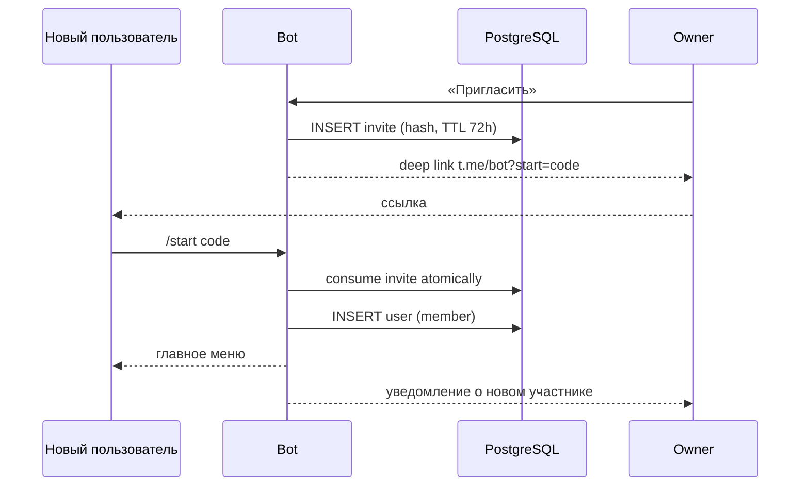

# Архитектура Tasklerq

## 1. Контекст

Tasklerq — семейный сервис, который работает на собственном сервере и
объединяет три интерфейса:

- **Telegram** — основной способ добавить, посмотреть и завершить задачу.
- **Home Assistant** — нативные сущности `todo` и `calendar` для дашбордов,
  автоматизаций и голосового capture через Assist.
- **HTTP API** — внешний capture от автоматизаций и других клиентов, в том
  числе без работающего бота.
- **Календарь** — задачи со сроком, включая повторяющиеся вхождения.

Сервис не является SaaS: один экземпляр обслуживает один household (семью).
Данные хранятся в PostgreSQL, который уже есть на сервере пользователя.
LLM-разбор выполняет Home Assistant через `ai_task.generate_data` (сейчас
Claude Haiku 5.5 через OpenRouter); Tasklerq не вызывает LLM напрямую. Задачу можно создать из Telegram
или без него — голосом, автоматизацией или прямым HTTP-запросом.

### Ограничения

| Ограничение | Следствие |
| --- | --- |
| Rust | Один бинарник, строгая типизация, tokio-воркеры. |
| PostgreSQL | Очереди и состояние — в БД, без Redis/Kafka. |
| Telegram webhook | Нужен публичный HTTPS и reverse proxy. |
| RichMessage — молодой API | Собственный адаптер и contract-тесты. |
| HA Container | Custom component, без add-on/ingress. |
| LLM через HA | LLM-клиент — HA REST, не прямой API. |
| Capture без Telegram | Отдельный API, HA-сервис и auto-режим; бот не обязателен. |
| Семейный масштаб | Монолит, один экземпляр, без шардирования. |

## 2. Компоненты



| Компонент | Роль | Технологии |
| --- | --- | --- |
| **Tasklerq core** | Домен, API, webhook, очереди, планировщик | Rust, axum, tokio, sqlx |
| **Telegram adapter** | RichMessage, вызовы Bot API | reqwest, teloxide-core types |
| **PostgreSQL** | Source of truth, очередь обновлений, outbox, черновики | PostgreSQL 18 (`postgres:18-alpine`) |
| **HA custom component** | Мост между REST API и сущностями HA | Python, aiohttp, HA integration |
| **HA AI Task** | Структурированный вызов LLM (Claude Haiku 5.5 через OpenRouter) | `ai_task.anthropic_claude_haiku_5_5`, `ai_task.generate_data` |
| **Reverse proxy** | TLS, публикация webhook | Synology DSM Reverse Proxy |

## 3. Потоки данных

### 3.1 Входящее сообщение Telegram



Ключевые свойства:

- webhook отвечает быстро, потому что обработка идёт в воркере;
- `update_id` — первичный ключ, повторная доставка не создаёт дубль;
- воркер может безопасно работать в нескольких экземплярах благодаря
  `SKIP LOCKED`;
- исходящие сообщения не теряются при сбое Telegram.

### 3.2 LLM-capture



LLM не пишет в базу и не вызывает инструменты. В Telegram валидный ответ не
применяется без подтверждения. Внешний capture в режиме `auto` применяет его
сразу, но только после серверной валидации и в одной транзакции.

Внешний capture:



Внешний capture не создаёт запись в `outbox` и не требует Telegram. При
недоступности LLM `auto` создаёт одну позицию из исходного текста.

### 3.3 Home Assistant snapshot и запись



Polling выбран из-за простоты и надёжности. Запись из HA инициирует
внеочередной refresh, чтобы интерфейс обновился быстрее.

### 3.4 Напоминания



Уникальный ключ `(user_id, item_id, occurrence_key, kind)` защищает от дублей
после перезапуска. Тихие часы сдвигают доставку, но не теряют её.

### 3.5 Онбординг и приглашение



## 4. Модули Rust

```text
src/
├── main.rs              # сборка зависимостей, запуск axum + workers
├── config/              # env, валидация, секреты
│   ├── mod.rs
│   └── env_source.rs
├── http/
│   ├── router.rs        # /api/v1, /webhooks, /health
│   ├── server.rs        # запуск axum и graceful shutdown
│   ├── middleware.rs    # request_id, auth, rate limit, body limit
│   └── error.rs         # единый формат ошибок
├── auth/
│   ├── tokens.rs        # API-токены: выпуск, отзыв, scopes, хеширование
│   ├── secrets.rs       # случайные секреты (токены, коды приглашений)
│   └── access.rs        # роли owner/member, системные акторы
├── telegram/
│   ├── api.rs           # trait TelegramApi + HTTP-клиент
│   ├── rich.rs          # RichMessage DTO и рендерер
│   ├── webhook.rs       # приём и постановка в очередь
│   ├── worker.rs        # обработка updates
│   ├── callbacks.rs     # токены и маршрутизация
│   ├── views.rs         # экраны и состояние
│   └── outbox.rs        # исходящие сообщения
├── domain/
│   ├── household.rs
│   ├── lists.rs
│   ├── items.rs
│   ├── recurrence.rs
│   ├── tags.rs
│   ├── events.rs
│   └── search.rs
├── capture/
│   ├── service.rs       # оркестрация разбора
│   ├── schema.rs        # JSON schema
│   ├── prompt.rs        # версионированный промпт
│   └── validation.rs    # доменная валидация
├── home_assistant/
│   ├── client.rs        # REST + ai_task
│   └── models.rs
├── storage/
│   ├── repositories/
│   ├── migrations.rs
│   └── queue.rs
├── jobs/
│   ├── scheduler.rs
│   ├── retention.rs
│   └── purge.rs
└── admin/
    └── cli.rs
```

Границы модулей:

- `http` не содержит бизнес-логики, только разбор запросов и вызовы сервисов.
- `domain` не знает про Telegram и HA; он работает с household, списками и
  элементами.
- `telegram` зависит от `domain` и `capture`, но не наоборот.
- `capture` зависит от `home_assistant` и `domain`.
- `storage` реализует порты, определённые доменом.

## 5. Согласованность и идемпотентность

| Операция | Механизм |
| --- | --- |
| Повтор webhook | `telegram_updates.update_id` PK, `ON CONFLICT DO NOTHING`. |
| Повтор callback | Одноразовый токен, атомарное потребление. |
| Повтор подтверждения черновика | `capture_drafts.status = applied`, уникальный `draft_id`. |
| Повтор завершения задачи | Проверка статуса, событие только при переходе. |
| Повтор напоминания | Уникальный `notification_deliveries`. |
| Повтор отправки | `outbox.message_id`, идемпотентный edit. |
| Конфликт редактирования | `version` + `409`. |
| Удаление | Soft delete, идемпотентное восстановление. |

Транзакции обязательны для:

- применения черновика (все элементы);
- завершения повторяющейся задачи (событие + новый срок);
- очистки выполненных;
- удаления участника (назначения + приглашения + доступ);
- подтверждения приглашения (использование + создание пользователя).

## 6. Время и повторения

- `due_at` — `timestamptz` в UTC.
- `due_date` — `date` без времени.
- `recurrence_timezone` — IANA; по умолчанию timezone household.
- Повторение считается по локальному настенному времени: 09:00 остаётся 09:00
  при смене DST.
- Якорь серии (`recurrence_anchor_date`) не меняется при завершении; это
  предотвращает дрейф месячных и годовых серий.
- 31-е число (`month_rule = anchor_day`): месяцы без 31-го пропускаются.
- Последний день месяца (`month_rule = last_day`): 28/29/30/31 без пропусков.
- 29 февраля: невисокосные годы пропускаются.
- Развёртка календаря: максимум 366 дней и 1000 вхождений на запрос.
- Следующее вхождение — первое строго позже и текущего срока, и момента
  завершения.
- Завершение серии после `until` переводит задачу в `done` без следующего срока.

Подробные примеры — в [`domain-model.md`](domain-model.md#7-повторения).

## 7. API

Базовый путь: `/api/v1` (health-эндпоинты — вне него). Аутентификация —
`Authorization: Bearer <token>`. Все ответы — JSON; время — RFC 3339;
идентификаторы — UUID.

| Метод | Путь | Назначение |
| --- | --- | --- |
| `GET` | `/health/live` | Процесс жив. |
| `GET` | `/health/ready` | БД, миграции, очередь. |
| `GET` | `/api/v1/household` | Household, участники, настройки. |
| `GET` | `/api/v1/lists` | Списки. |
| `POST` | `/api/v1/lists` | Создать список. |
| `PATCH` | `/api/v1/lists/{id}` | Переименовать/архивировать. |
| `DELETE` | `/api/v1/lists/{id}` | Мягко удалить. |
| `GET` | `/api/v1/lists/{id}/items` | Позиции списка. |
| `POST` | `/api/v1/lists/{id}/items` | Создать задачу/позицию. |
| `GET` | `/api/v1/items/{id}` | Карточка. |
| `PATCH` | `/api/v1/items/{id}` | Изменить (нужна `version`). |
| `DELETE` | `/api/v1/items/{id}` | Мягко удалить. |
| `POST` | `/api/v1/items/{id}/complete` | Завершить. |
| `POST` | `/api/v1/items/{id}/reopen` | Открыть. |
| `POST` | `/api/v1/items/{id}/undo` | Отменить последнее действие. |
| `POST` | `/api/v1/capture` | Внешний capture без Telegram (`auto`/`draft`). |
| `POST` | `/api/v1/captures/{id}/confirm` | Подтвердить внешний черновик. |
| `POST` | `/api/v1/captures/{id}/cancel` | Отменить внешний черновик. |
| `POST` | `/api/v1/captures/{id}/undo` | Отменить применённый capture. |
| `POST` | `/api/v1/captures/undo-last` | Отменить последний голосовой capture. |
| `GET` | `/api/v1/search` | Поиск. |
| `GET` | `/api/v1/calendar` | Вхождения за интервал. |
| `GET` | `/api/v1/snapshot` | Инкрементальный снапшот для HA. |

Точный контракт для клиента Home Assistant — поля, коды и семантика
курсора: [`ha-api.md`](ha-api.md).

Ошибки:

```json
{
  "error": {
    "code": "conflict",
    "message": "Task was modified",
    "details": {"current_version": 4},
    "request_id": "01J..."
  }
}
```

Коды: `validation_error` (422), `unauthorized` (401), `forbidden` (403),
`not_found` (404), `conflict` (409), `gone` (410), `rate_limited` (429),
`internal_error` (500), `service_unavailable` (503),
`payload_too_large` (413), `unsupported_media_type` (415),
`method_not_allowed` (405). Сообщения API — английские для разработчиков; бот
и HA переводят их на русский. Отказы разбора JSON-тела на маршрутах списков
и позиций приходят от axum как текст с `400`/`415`/`422`, без этого конверта;
`POST /capture` всегда отдаёт конверт.

### Snapshot

`GET /api/v1/snapshot?since=<cursor>&calendar_end=<date>`:

```json
{
  "server_time": "2026-11-03T12:00:00Z",
  "next_since": "2026-11-03T11:59:55Z",
  "lists": [],
  "items": [],
  "deleted_item_ids": [],
  "calendar_events": [],
  "calendar_truncated": false
}
```

`since` — курсор из предыдущего ответа. При первом запросе или смене токена
параметр `since` не передаётся (пустая строка — ошибка `422`), и возвращается
полный снапшот. `next_since` — это `server_time` минус 5 секунд перекрытия
(защита от конкурентных коммитов); компонент применяет изменения
идемпотентно по `id`, а `version` использует для записи и проверки конфликтов.

`lists` в снапшоте всегда полный (включая архивные) и не зависит от `since`;
отдельного массива удалённых списков нет — компонент сравнивает набор `id` с
локальным. `deleted_item_ids` приходит только в инкрементальном ответе; при
полной синхронизации удаления определяются отсутствием позиции в `items`.

`calendar_events` возвращаются, только если передан `calendar_end` (не позже
366 дней от сегодня). Календарь в снапшоте вспомогательный: при более чем 1000
вхождений ответ усекается по раннему началу и приходит `calendar_truncated:
true`, а не ошибка, чтобы синхронизация `todo` не зависела от календаря. Полный
горизонт компонент берёт через `GET /api/v1/calendar`.

## 8. Home Assistant component

Компонент поставляется из отдельного репозитория `tasklerq-ha`; ниже —
структура его каталога.

```text
custom_components/tasklerq/
├── __init__.py          # entry setup, coordinator, unload
├── manifest.json        # domain, version, requirements, iot_class
├── config_flow.py       # URL + token, reauth, options
├── api.py               # aiohttp client
├── coordinator.py       # DataUpdateCoordinator + snapshot cursor
├── todo.py              # TodoListEntity per list
├── calendar.py          # CalendarEntity
├── diagnostics.py       # redacted dump
├── services.py          # capture / confirm / cancel / undo_last_capture
├── services.yaml        # описания полей сервисов
├── const.py
├── strings.json
└── translations/ru.json
```

- `todo`-сущность на каждый неархивированный список.
- `calendar.tasklerq` — одна read-only сущность для задач со сроком.
- `unique_id`: `tasklerq:<household_uuid>:<list_uuid>`.
- Дополнительные поля — в атрибуте `tasklerq_items`.
- Сервис `tasklerq.capture` вызывает `POST /api/v1/capture`; для HA Assist
  поставляется пример пользовательских предложений (custom sentences) +
  `intent_script`.
- Polling 60 с, backoff до 5 минут, reauth при 401.
- Запись передаёт `version`; при 409 — refresh и ошибка.

Подробно: [`home-assistant.md`](home-assistant.md).

## 9. Развёртывание

```text
Telegram ──443──▶ Synology Reverse Proxy ──▶ 127.0.0.1:18080 tasklerq
                                                    │
                    ┌───────────────────────────────┼──────────────────────┐
                    ▼                               ▼                      ▼
              PostgreSQL 18                  HA Container             api.telegram.org
              shared-db:5432                 network_mode: host
                    ▲                               │
                    └──────── SQL ─────────────────┤
                                                    ▼
                                             HA AI Task → OpenRouter
```

- Tasklerq — bridge-контейнер; host-порт `18080` публикуется только на
  loopback (`8080` занят Zigbee2MQTT).
- HA работает в `network_mode: host`; HA → Tasklerq:
  `http://127.0.0.1:18080`, Tasklerq → HA:
  `http://host.docker.internal:8123` (или `http://192.168.10.110:8123`).
- PostgreSQL — контейнер `postgres:18-alpine` в сети `shared-db`; Tasklerq не
  управляет сервером БД.
- TLS завершается Synology Reverse Proxy; webhook доступен только по HTTPS.
- Секреты — env-file 0600 или Docker secrets.
- Миграции — при старте под advisory lock или отдельной командой.
- Backup — ежедневный `pg_dump` (14 дней) + Hyper Backup на внешний диск.

Подробно: [`deployment.md`](deployment.md).

## 10. Безопасность

| Слой | Мера |
| --- | --- |
| Webhook | Секрет, constant-time, 401, лимит тела 1 МБ. |
| API | Bearer-токены, SHA-256 хеш, scopes, revoke. |
| Capture API | `capture:write`, лимит тела/текста, rate limit, `Idempotency-Key`. |
| Tenant | `household_id` во всех запросах, 404 для чужих. |
| Callback | Одноразовые токены, привязка к user, TTL. |
| Ввод | Валидация, экранирование HTML, параметризованный SQL. |
| LLM | Делимитеры, schema-only, без инструментов, валидация, подтверждение. |
| Секреты | env/secret files, redaction, ротация. |
| Абьюз | Rate limits, LLM-квота, 429. |
| Приватность | Минимизация, отсутствие текста в логах, retention. |

Подробно: [`security-privacy` spec](../openspec/changes/0001-foundation/specs/security-privacy/spec.md).

## 11. Наблюдаемость

- JSON-логи с `request_id`, `update_id`, `route`, `status`, `duration_ms`,
  `error_code`, `version`.
- Метрики: обновления, задержка очереди, outbox, capture по источникам,
  fallback, LLM, HTTP, пул БД.
- `/health/live` — процесс; `/health/ready` — БД, миграции, очередь.
- Алерты: readiness >2 мин, queue lag >5 мин, LLM errors >20%, backup failed,
  webhook auth failures >50/5 мин.

Текст сообщений, токены и имена в логи не попадают.

## 12. Тестирование

| Уровень | Что проверяет |
| --- | --- |
| Unit | Валидация, повторения, timezone/DST, RichMessage, callback-токены. |
| Integration | PostgreSQL через testcontainers, транзакции, очередь, миграции. |
| Contract | Mock Telegram и mock HA, схема `ai_task.generate_data`. |
| Python | Config flow, todo, calendar, diagnostics, конфликты. |
| E2E | Docker compose + fake Telegram + fake HA. |
| LLM eval | ≥30 фраз, точность извлечения ≥90%. |
| Load | 10 пользователей, 10 000 задач, 50 webhook/с. |

## 13. Ключевые решения (ADR)

| # | Решение | Альтернативы | Причина |
| --- | --- | --- | --- |
| 1 | Модульный монолит на Rust | Микросервисы, Python/Node | Семейный масштаб, один деплой, строгая типизация. |
| 2 | PostgreSQL для очередей | Redis, RabbitMQ | Уже есть; меньше инфраструктуры; `SKIP LOCKED`. |
| 3 | Webhook + очередь | Long polling, inline | Требование webhook; устойчивость к таймаутам. |
| 4 | Собственный RichMessage-адаптер | teloxide dispatcher | teloxide не поддерживает RichMessage. |
| 5 | LLM только разбор | LLM с инструментами | Безопасность, контроль, подтверждение. |
| 6 | HA custom component | MQTT, CalDAV, AppDaemon | Нативные `todo`/`calendar`, HA Container. |
| 7 | Polling HA 60 с | Webhook в HA, websocket | Простота, надёжность, достаточная задержка. |
| 8 | Один household | Мультитенантность | Семейный сценарий, простая авторизация. |
| 9 | Единые `items` | Отдельные tasks/shopping | Общие операции, поиск, события, HA. |
| 10 | UUIDv7 | UUIDv4, bigserial | Сортировка по времени, безопасность в URL. |

## 14. Границы масштаба

- До ~10 пользователей и ~10 000 активных задач.
- Один экземпляр сервиса; несколько экземпляров допустимы за счёт
  `SKIP LOCKED`, но не обязательны.
- Polling HA создаёт нагрузку O(изменённых элементов) на клиента, а не полный
  дамп.
- Календарь ограничен 366 днями и 1000 вхождениями.
- LLM-квота по умолчанию 200 разборов в сутки на household.

## 15. Открытые вопросы

Среда уже известна: Synology NAS, HA Container `2026.10.4` в
`network_mode: host`, HACS, PostgreSQL 18 в сети `shared-db`, Synology Reverse
Proxy, домен `tasklerq.stellalupus.ru`, бот `@tasklerqbot`, часовой пояс
`Europe/Moscow`, backup — Hyper Backup на внешний диск.

Осталось уточнить:

- бюджет LLM при квоте 200 разборов в сутки (модель AI Task выбирается в HA).
