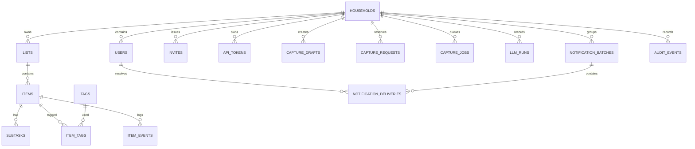

# Модель данных Tasklerq

## 1. Принципы

- **PostgreSQL — source of truth.** Очереди, черновики, уведомления и outbox
  живут в тех же таблицах, что и домен.
- **Один household на пользователя.** `household_id` — tenant-ключ всех
  запросов.
- **Единая таблица `items`.** Задачи, покупки и чек-листы имеют общий жизненный
  цикл; различия — в `lists.kind` и nullable-полях.
- **UUIDv7.** Сортировка по времени, безопасные идентификаторы в URL.
- **Мягкое удаление.** Элементы скрываются; вернуть удалённое можно только
  отменой (undo) в течение 10 минут, отдельного восстановления нет. Через
  30 дней retention удаляет данные физически; списки и household — так же.
- **Версии.** Каждое изменение элемента увеличивает `version`; `PATCH` требует
  `version`, `complete`/`reopen` принимают её опционально, устаревшая версия
  отклоняется (`409`).
- **Аудит.** Значимые изменения пишутся в `item_events`; членство и
  безопасность — в `audit_events`.

## 2. ER-диаграмма



## 3. Таблицы

### 3.1 `households`

| Поле | Тип | Ограничения |
| --- | --- | --- |
| `id` | `uuid` | PK, UUIDv7. |
| `name` | `text` | 1..100 символов. |
| `timezone` | `text` | IANA, по умолчанию `Europe/Moscow`. |
| `created_at` | `timestamptz` | NOT NULL. |
| `updated_at` | `timestamptz` | NOT NULL. |
| `deleted_at` | `timestamptz` | NULL, soft delete. |

### 3.2 `users`

| Поле | Тип | Ограничения |
| --- | --- | --- |
| `id` | `uuid` | PK. |
| `household_id` | `uuid` | FK → households, NOT NULL. |
| `telegram_user_id` | `bigint` | NOT NULL; UNIQUE среди `deleted_at IS NULL` (удалённый участник может вернуться по новому приглашению). |
| `telegram_chat_id` | `bigint` | NOT NULL; в приватном чате равен `telegram_user_id` (CLI `user add` задаёт его сам). |
| `display_name` | `text` | 1..64. |
| `username` | `text` | NULL, до 64. |
| `role` | `user_role` | `owner`/`member`. |
| `timezone` | `text` | NULL → используется timezone household. |
| `settings` | `jsonb` | `{"notifications": {...}}`: напоминания, сводка, назначения, lead time (5..1440 мин), время сводки и напоминания о задачах на весь день, тихие часы. Отсутствующие поля принимают значения по умолчанию. |
| `created_at`, `updated_at` | `timestamptz` | NOT NULL. |
| `deleted_at` | `timestamptz` | NULL. |

Один пользователь — один household. При удалении участника строка остаётся с
`deleted_at`, чтобы сохранить авторство задач. В household не более одного
активного `owner` (частичный UNIQUE по `household_id` для `role = 'owner'`);
владение передаётся в одной транзакции. `telegram_user_id` не редактируется.

### 3.3 `lists`

| Поле | Тип | Ограничения |
| --- | --- | --- |
| `id` | `uuid` | PK. |
| `household_id` | `uuid` | FK → households. |
| `kind` | `list_kind` | `tasks`/`shopping`/`checklist`. |
| `name` | `text` | 1..64. |
| `is_default` | `boolean` | Не более одного default на kind. |
| `is_archived` | `boolean` | По умолчанию false. |
| `position` | `integer` | Порядок в меню. |
| `created_at`, `updated_at` | `timestamptz` | NOT NULL. |
| `deleted_at` | `timestamptz` | NULL. |

Инварианты:

- default-список нельзя архивировать или удалять;
- имя уникально в household без учёта регистра среди неудалённых;
- не более 20 списков на household.

### 3.4 `items`

| Поле | Тип | Ограничения |
| --- | --- | --- |
| `id` | `uuid` | PK. |
| `household_id` | `uuid` | FK → households. |
| `list_id` | `uuid` | FK → lists, тот же household. |
| `title` | `text` | 1..200. |
| `notes` | `text` | NULL, до 2000. |
| `status` | `item_status` | `open`/`done`. |
| `priority` | `item_priority` | По умолчанию `normal`. |
| `due_at` | `timestamptz` | NULL; взаимоисключающе с `due_date`. |
| `due_date` | `date` | NULL; all-day. |
| `assignee_user_id` | `uuid` | NULL, FK → users; приложение проверяет тот же household. |
| `created_by_user_id` | `uuid` | NULL для системных источников; FK → users. |
| `source` | `item_source` | `telegram`/`ha_todo`/`ha_voice`/`ha_automation`/`api`/`import`. |
| `capture_id` | `uuid` | NULL, FK → `capture_drafts`; для внешнего capture. |
| `completed_at` | `timestamptz` | NULL. |
| `completed_by_user_id` | `uuid` | NULL. |
| `quantity` | `numeric(7,3)` | NULL или >0..9999.999. |
| `unit` | `text` | NULL или 0..16. |
| `position` | `integer` | Порядок в списке. |
| `version` | `integer` | ≥1, увеличивается при изменении. |
| `recurrence_freq` | `recurrence_freq` | NULL для не-повторяющихся. |
| `recurrence_interval` | `smallint` | 1..365. |
| `recurrence_byweekday` | `smallint[]` | ISO 1..7, только weekly. |
| `recurrence_until` | `date` | NULL. |
| `recurrence_timezone` | `text` | IANA. |
| `recurrence_anchor_date` | `date` | Исходная дата серии. |
| `recurrence_month_rule` | `month_rule` | Только для monthly: `anchor_day` (по умолчанию) или `last_day`. |
| `recurrence_occurrence_date` | `date` | NULL или дата правила, которую занимает перенесённое вхождение. |
| `recurrence_occurrence_time` | `time` | NULL или локальное время серии в `recurrence_timezone` при заданной дате слота; `NULL` — вседневная серия. |
| `search_vector` | `tsvector` | Генерируемая колонка. |
| `created_at`, `updated_at` | `timestamptz` | NOT NULL. |
| `deleted_at` | `timestamptz` | NULL. |

Check-ограничения:

```sql
CHECK (due_at IS NULL OR due_date IS NULL)
CHECK (quantity IS NULL OR (quantity > 0 AND quantity <= 9999.999))
CHECK (char_length(unit) <= 16)
CHECK (version >= 1)
CHECK (
  recurrence_freq IS NULL
  OR (recurrence_interval BETWEEN 1 AND 365
      AND recurrence_timezone IS NOT NULL
      AND recurrence_anchor_date IS NOT NULL)
)
CHECK (
  recurrence_freq IS NOT NULL
  OR (recurrence_interval IS NULL
      AND recurrence_byweekday IS NULL
      AND recurrence_until IS NULL
      AND recurrence_timezone IS NULL
      AND recurrence_anchor_date IS NULL
      AND recurrence_month_rule IS NULL
      AND recurrence_occurrence_date IS NULL
      AND recurrence_occurrence_time IS NULL)
)
CHECK (recurrence_occurrence_time IS NULL
       OR recurrence_occurrence_date IS NOT NULL)
CHECK (
  recurrence_freq IS DISTINCT FROM 'weekly'
  OR (recurrence_byweekday IS NOT NULL AND cardinality(recurrence_byweekday) > 0)
)
CHECK (recurrence_byweekday IS NULL
       OR recurrence_byweekday <@ ARRAY[1, 2, 3, 4, 5, 6, 7]::smallint[])
CHECK (recurrence_freq IS DISTINCT FROM 'monthly'
       OR recurrence_month_rule IS NOT NULL)
CHECK (recurrence_freq = 'monthly' OR recurrence_month_rule IS NULL)
CHECK (recurrence_until IS NULL
       OR (recurrence_until >= recurrence_anchor_date
           AND recurrence_until <= (recurrence_anchor_date + INTERVAL '5 years')::date))
```

Дополнительно приложение проверяет, что повторение допустимо только для
`lists.kind = 'tasks'`, а `quantity`/`unit` — только для shopping/checklist.

### 3.5 `subtasks`

| Поле | Тип | Ограничения |
| --- | --- | --- |
| `id` | `uuid` | PK. |
| `item_id` | `uuid` | FK → items, ON DELETE CASCADE. |
| `title` | `text` | 1..200. |
| `status` | `item_status` | `open`/`done`. |
| `position` | `integer` | Порядок. |
| `created_at`, `completed_at` | `timestamptz` | `completed_at` NULL для open. |

Не более 50 подзадач на элемент.

### 3.6 `tags` и `item_tags`

`tags`:

| Поле | Тип | Ограничения |
| --- | --- | --- |
| `id` | `uuid` | PK. |
| `household_id` | `uuid` | FK → households. |
| `name` | `text` | 1..32, unique `(household_id, lower(name))`. |
| `created_at` | `timestamptz` | NOT NULL. |

`item_tags`: `(item_id, tag_id)` PK, оба FK с каскадным удалением. Не более 10
тегов на элемент.

### 3.7 `item_events`

| Поле | Тип | Назначение |
| --- | --- | --- |
| `id` | `uuid` | PK. |
| `household_id` | `uuid` | Tenant. |
| `item_id` | `uuid` | FK → items. |
| `actor_user_id` | `uuid` | NULL для системы/HA/голоса. |
| `actor_type` | `actor_type` | `user`/`system`/`home_assistant`/`voice`. |
| `event_type` | `event_type` | Тип события. |
| `payload` | `jsonb` | До/после, прежний срок, исполнитель. |
| `undo_of` | `uuid` | NULL; ссылка на отменяемое событие. |
| `created_at` | `timestamptz` | NOT NULL. |

Типы событий: `created`, `updated`, `completed`, `reopened`, `deleted`,
`assigned`, `unassigned`, `recurrence_changed`, `subtask_completed`,
`subtask_reopened`; `restored` зарезервирован в enum и в runtime не
выставляется: восстановление удалённой задачи выполняется только через undo,
которое пишет событие с `undo_of`. Тип события отмены: `deleted`, если после
отмены элемент удалён; `completed`, если после отмены он выполнен; `reopened`,
если он был выполнен, а после отмены открыт; иначе `updated`.

**Журнал выполнений** отдельной таблицы не имеет и строится из событий:
выполнение — это событие `completed`, для которого нет компенсирующего
события (`undo_of`), а также нет неотменённого события `reopened` после него
и до следующего `completed`. Отменённый через `undo_last` `reopened`
(компенсирующее событие с `undo_of = reopened.id`) выполнение не скрывает.
Правило покрывает и старые возвраты, записанные без `undo_of`. Название,
плановый срок и список берутся из снимка `payload.before` по отдельным полям,
поэтому битое поле не теряет запись; исполнитель — `actor_user_id`, факт —
`created_at`. Выполнения удалённых задач (`items.deleted_at IS NOT NULL`)
отбрасываются, а глубина журнала равна сроку хранения событий — 365 дней
(раздел 10).

### 3.8 `invites`

| Поле | Тип | Ограничения |
| --- | --- | --- |
| `id` | `uuid` | PK. |
| `household_id` | `uuid` | FK. |
| `code_hash` | `text` | UNIQUE, SHA-256 кода. |
| `role` | `user_role` | `member`. |
| `created_by_user_id` | `uuid` | FK. |
| `expires_at` | `timestamptz` | NOW() + 72h. |
| `used_by_user_id` | `uuid` | NULL. |
| `used_at` | `timestamptz` | NULL. |
| `revoked_at` | `timestamptz` | NULL. |
| `created_at` | `timestamptz` | NOT NULL. |

Не более 5 активных приглашений на household и не более 5 созданий в час на
household.

### 3.9 `api_tokens`

| Поле | Тип | Ограничения |
| --- | --- | --- |
| `id` | `uuid` | PK. |
| `household_id` | `uuid` | FK. |
| `name` | `text` | 1..64. |
| `token_hash` | `text` | UNIQUE, SHA-256. |
| `prefix` | `text` | Первые символы для отображения. |
| `scopes` | `text[]` | `ha:read`, `ha:write`, `capture:write`, `metrics:read`. |
| `created_by_user_id` | `uuid` | NULL для CLI. |
| `expires_at` | `timestamptz` | NULL. |
| `last_used_at` | `timestamptz` | NULL. |
| `revoked_at` | `timestamptz` | NULL. |
| `created_at` | `timestamptz` | NOT NULL. |

### 3.10 Очереди и состояние Telegram

`telegram_updates`:

| Поле | Тип | Назначение |
| --- | --- | --- |
| `update_id` | `bigint` | PK, `update_id` из Telegram. |
| `payload` | `jsonb` | Полный Update. |
| `status` | `update_status` | `pending`/`processed`/`dead`. Обработка идёт под `FOR UPDATE SKIP LOCKED`, поэтому отдельных `processing` и `failed` нет. После обработки `payload` заменяется на `{"redacted": true}`. |
| `attempts` | `integer` | По умолчанию 0. |
| `available_at` | `timestamptz` | Время следующей попытки. |
| `last_error` | `text` | Код/краткое описание. |
| `received_at`, `processed_at` | `timestamptz` | Время. |

`telegram_views`: `chat_id` PK, `message_id`, `view_key`, `state jsonb`,
`buried boolean` (якорь засыпан другим сообщением), `updated_at`.

`conversation_states`: `chat_id` PK, `telegram_user_id`, `kind`, `data jsonb`,
`expires_at`, `created_at`, `updated_at`; одна активная форма на чат, TTL
15 минут.

`callback_tokens`: `token_hash` PK, `telegram_user_id`, `household_id` (NULL
для онбординга), `scope` (`screen`/`notice`), `action`, `payload jsonb`,
`version`, `expires_at`, `consumed_at`, `created_at`; TTL не больше 24 часов.

### 3.11 Capture и LLM

`capture_drafts`:

| Поле | Тип | Назначение |
| --- | --- | --- |
| `id` | `uuid` | PK. |
| `household_id`, `user_id`, `chat_id` | | Владелец; `user_id`/`chat_id` NULL для внешнего capture. |
| `source` | `capture_source` | `telegram`/`ha_voice`/`ha_automation`/`api`/`shortcut`. |
| `mode` | `capture_mode` | `auto`/`draft`. |
| `idempotency_key` | `text` | NULL; повтор ключа в `capture_requests` уникален по `(household_id, source, idempotency_key)`. Резервируется до вызова LLM: параллельный повтор получает `409`. |
| `request_hash` | `text` | SHA-256 канонического тела запроса; тот же ключ с другим хешем — `422`. |
| `raw_text` | `text` | Исходный текст, до 2000. |
| `parsed` | `jsonb` | Разобранная структура, включая невалидные элементы до подтверждения. |
| `status` | `draft_status` | `pending`/`applied`/`cancelled`/`expired`; `rejected` зарезервирован в enum и пока не выставляется. |
| `fallback` | `boolean` | TRUE, если создано из исходного текста без LLM. |
| `prompt_version` | `text` | Например, `capture-v3`. |
| `telegram_message_id` | `bigint` | NULL. |
| `created_at`, `expires_at`, `applied_at` | `timestamptz` | `expires_at` — TTL подтверждения 15 минут; строка хранится вместе с `raw_text` 30 дней. |

`capture_requests`: `household_id`, `source`, `idempotency_key`, `request_hash`,
`capture_id`, `response jsonb` (NULL, пока запрос обрабатывается), `created_at`,
`completed_at`; UNIQUE `(household_id, source, idempotency_key)`. Завершённый
повтор возвращает сохранённый `response` без нового разбора; зависший резерв
перехватывается через 60 секунд.

`capture_jobs`: `id`, `household_id`, `user_id`, `chat_id`, `source`,
`input_kind`, `payload jsonb`, `status` (`capture_job_status`), `attempts`,
`available_at`, `locked_until`, `last_error`, `draft_id`, `created_at`,
`finished_at`. Задание захватывается арендой `locked_until`, поэтому упавший
воркер не теряет разбор; у `done` и `dead` текст `payload` заменяется на
`{"redacted": true}`.

`llm_runs`: `id`, `household_id`, `user_id`, `source`, `mode`,
`prompt_version`, `status` (`success`/`failure`), `error_code`, `latency_ms`,
`input_tokens`, `output_tokens`, `created_at`. Исходный текст и ответ модели не
хранятся.

### 3.12 Outbox и уведомления

`outbox`: `seq`, `chat_id`, `kind` (`outbox_kind`), `payload jsonb`,
`dedupe_key`, `status` (`pending`/`sent`/`dead`/`skipped`), `attempts`,
`next_attempt_at`, `message_id`, `last_error`, `created_at`, `sent_at`,
`dead_at`. `dead_at` заполняется при переводе в `dead` и пуст у остальных
статусов. В `sent`, `skipped` и `dead` текст `payload` заменяется на
`{"redacted": true}`.

`notification_deliveries`: `id`, `household_id`, `user_id`, `item_id` (NULL для
сводки), `occurrence_key`, `origin_key`, `kind`, `status`, `scheduled_at`, `deferred`,
`outbox_seq`, `batch_id`, `batch_version`, `batch_state`, `batch_snoozed_until`,
`batched`, `created_at`, `updated_at`; UNIQUE `(user_id, item_id,
occurrence_key, kind)`. `kind` — `reminder`, `digest`, `assignment` или
`snooze`; `status` — `pending`, `sent` или `cancelled`. `deferred` отмечает
запись, хотя бы раз отложенную тихими часами: перенесённая через полночь
сводка или вседневное напоминание не отменяются только из-за смены локальной
даты. `snooze` — отдельная доставка отложенного напоминания, её ключ включает
время snooze. `origin_key` — вхождение срока, из которого отложили snooze:
ключ напоминания (`due_at` в UTC или `date:YYYY-MM-DD`), `no-due` у задачи без
срока; у остальных видов пусто. Отложенное («😴») напоминание отменяется, если
к моменту доставки у получателя выключены напоминания, а также когда
`snooze_origin` текущего срока не равен `origin_key`. Повторный snooze на то же
время перепривязывает `pending`- или `cancelled`-запись к текущему вхождению: upsert
сбрасывает `deferred` и `batched`, переписывает `scheduled_at` и `outbox_seq`,
но не трогает `batch_id`, `batch_version` и `batch_state`. `batch_id` связывает
доставку со сводным сообщением, `batch_version` хранит версию задачи на момент
выпуска, `batch_state` — итог действия над блоком (`done`/`snoozed`/`missing`),
`batched` отмечает групповой snooze.
Для сводок `item_id` равен NULL, поэтому уникальность обеспечивается
`UNIQUE NULLS NOT DISTINCT` (PostgreSQL 15+). Составные внешние ключи
`(user_id, household_id)` и `(item_id, household_id)` не дают записать
получателя или элемент из чужого household. `outbox_seq` ссылается на
поставленное сообщение; после retention outbox ссылка обнуляется, а запись
доставки остаётся для аудита дедупликации. Завершённые доставки (`sent`,
`cancelled`) хранятся 30 дней (`RETENTION_OUTBOX_DAYS`); `pending` не удаляются.

`notification_batches`: `id`, `household_id`, `user_id`, `chat_id`, `page`
(текущая страница сводного), `result_completed`, `result_changed`,
`created_at`, `updated_at`. Хранит одно выпущенное сводное сообщение; батч
удаляется retention, когда на него больше не ссылается ни одна доставка.

### 3.13 `audit_events`

`id`, `household_id` (NULL для системных), `actor_user_id`, `actor_type`
(источник: `user`/`system`/`home_assistant`/`voice`), `event_type`, `payload
jsonb`, `created_at`. Типы: `household_created`, `member_joined`,
`member_left`, `member_removed`, `role_changed`, `invite_created`,
`invite_used`, `invite_revoked`, `token_created`, `token_revoked`,
`auth_failed`, `rate_limited`, `llm_validation_failed`,
`auth_failure_threshold_exceeded`, `household_deleted`.

Раздел «Журнал» владельца показывает события членства
(`household_created`, `member_*`, `role_changed`, `invite_*`,
`household_deleted`) за 90 дней; события токенов и безопасности остаются в
аудите. Payload собирается из явных полей и не содержит кодов приглашений,
токенов и хешей; имена хранятся снимком на момент события. Участники и
household, созданные через `tasklerq admin`, попадают в журнал от имени
системного актора (`actor_type = system`).

## 4. Перечисления

| Тип | Значения |
| --- | --- |
| `user_role` | `owner`, `member` |
| `list_kind` | `tasks`, `shopping`, `checklist` |
| `item_status` | `open`, `done` |
| `item_priority` | `low`, `normal`, `high`, `urgent` |
| `recurrence_freq` | `daily`, `weekly`, `monthly`, `yearly` |
| `month_rule` | `anchor_day`, `last_day` |
| `actor_type` | `user`, `system`, `home_assistant`, `voice` |
| `event_type` | `created`, `updated`, `completed`, `reopened`, `deleted`, `assigned`, `unassigned`, `recurrence_changed`, `subtask_completed`, `subtask_reopened`; `restored` зарезервирован |
| `update_status` | `pending`, `processed`, `dead` |
| `draft_status` | `pending`, `applied`, `cancelled`, `expired`; `rejected` зарезервирован |
| `capture_source` | `telegram`, `ha_voice`, `ha_automation`, `api`, `shortcut` |
| `capture_mode` | `auto`, `draft` |
| `item_source` | `telegram`, `ha_todo`, `ha_voice`, `ha_automation`, `api`, `import` |
| `outbox_status` | `pending`, `sent`, `dead`, `skipped` |
| `outbox_kind` | `screen`, `message`, `edit`, `delete` |
| `notification_kind` | `reminder`, `digest`, `assignment`, `snooze` |
| `notification_status` | `pending`, `sent`, `cancelled` |
| `capture_job_status` | `pending`, `running`, `done`, `dead` |
| `audit_event_type` | `household_created`, `member_joined`, `member_left`, `member_removed`, `role_changed`, `invite_created`, `invite_used`, `invite_revoked`, `token_created`, `token_revoked`, `auth_failed`, `rate_limited`, `llm_validation_failed`, `auth_failure_threshold_exceeded`, `household_deleted` |

## 5. Инварианты

1. Элемент и его список принадлежат одному household.
2. `due_at` и `due_date` не могут быть заполнены одновременно.
3. Повторение допустимо только для `tasks`; `weekly` требует непустой
   `byweekday`; `interval` 1..365; `until` не раньше якоря и не позже +5 лет.
4. `quantity` >0..9999.999; `unit` до 16 символов.
5. `title` 1..200; `notes` до 2000; тегов ≤10; подзадач ≤50.
6. Исполнитель — участник того же household; автор-пользователь, если указан,
   тоже участник. Для системного источника `created_by_user_id` может быть NULL.
7. В household ровно один default-список `tasks` и один default-список
   `shopping`; их нельзя удалить/архивировать.
8. `done` требует `completed_at`; `completed_by_user_id` заполняется, если
   действие совершил пользователь, и остаётся NULL у системных источников.
9. `version` монотонно растёт; конфликт версий не применяется.
10. Удалённые элементы не видны в API, поиске, календаре и HA.
11. Пользователь состоит не более чем в одном household.
12. Тег уникален в household без учёта регистра.
13. Приглашение одноразовое; код хранится только как хеш.
14. API-токен хранится только как хеш; scopes обязательны.
15. Ключ уведомления уникален; повтор не создаёт дубль.
16. Ключ `idempotency_key` внешнего capture уникален в рамках
    `(household_id, source)`; повтор возвращает исходный результат.
17. Все элементы одного capture создаются и отменяются вместе; частичного
    применения нет.
18. `source` элемента неизменяем; `capture_id` очищается при retention, элемент
    остаётся.
19. `capture_drafts.source=shortcut` создаёт элементы с `items.source=api`;
    `ha_voice` и `ha_automation` сохраняются как есть.

## 6. Состояния

### Элемент

```text
           complete                 reopen
  open ───────────────▶ done ───────────────▶ open
    │                     │
    │ delete              │ delete
    ▼                     ▼
 deleted ◀────────────── deleted
    │ undo (10 мин)       │ undo (10 мин)
    └────────▶ open       └────────▶ done
```

Мягкое удаление сохраняет прежний статус; отмена удаления возвращает его.
Отдельного восстановления нет: удаление отменяется только через undo в
течение 10 минут, после 30 дней retention удаляет запись физически.
Событие отмены ссылается на отменяемое через `undo_of`; его тип определяется
результатом: `deleted`, если после отмены элемент удалён; `completed`, если
после отмены он выполнен; `reopened`, если он был выполнен, а после отмены
открыт; иначе `updated`.
Повторяющаяся задача после завершения остаётся `open` с новым сроком, если
следующее вхождение существует; иначе становится `done`.

**Возврат выполнения.** `revert_completion(item_id, completion_id)` возвращает
только последнее неотменённое выполнение элемента. У задачи без повторения
возврат действует как `reopen`, но пишет `undo_of`. У повторяющейся задачи
возврат допустим, только пока `items.version` равна версии из `payload.after`
выполнения, то есть задачу не меняли после него; иначе операция возвращает
конфликт и ничего не меняет.
Возврат ставит элемент в `open`, восстанавливает из `payload.before`
`due_at`/`due_date`, слот вхождения
(`recurrence_occurrence_date`/`recurrence_occurrence_time`) и
`completed_at`/`completed_by_user_id`, увеличивает `version` и пишет
`reopened` с `undo_of = completion_id`. Поэтому выполнение перестаёт попадать
в журнал по правилу неотменённого выполнения.

### Черновик

```text
pending ──confirm──▶ applied
   │
   ├──cancel──▶ cancelled
   └──ttl─────▶ expired
```

`applied`, `cancelled`, `expired` — терминальные. Значение `rejected` в enum
`draft_status` зарезервировано и пока нигде не выставляется: отказ разбора
(`status=rejected` в ответе capture) не создаёт черновик.

### Очередь обновлений

```text
pending ──ok──▶ processed
   │
   ├──retry (attempts+1, available_at)──▶ pending
   └──max attempts──▶ dead
```

### Outbox

```text
pending ──ok──▶ sent
   │
   ├──retry (attempts+1, next_attempt_at)──▶ pending
   ├──удалено/недоступно──▶ skipped
   └──max attempts──▶ dead
```

### Приглашение

```text
active ──use──▶ used
   ├──revoke──▶ revoked
   └──ttl─────▶ expired
```

## 7. Повторения

### Правило

```text
freq:      daily | weekly | monthly | yearly
interval:  1..365
weekdays:  ISO 1..7, только weekly
month_rule: anchor_day | last_day, только monthly
until:     date | null
timezone:  IANA
anchor:    date — исходная дата серии
slot:      date | null — дата правила, которую занимает перенесённое вхождение
slot_time: time | null — время суток серии при заданной дате слота
```

Текущий срок (`due_at`/`due_date`) — ближайшее вхождение. Следующее вхождение
вычисляется от якоря, а не от текущего срока. Если срок при создании не указан
(например, LLM вернула только правило), якорем и первым сроком становится
ближайшее по правилу вхождение не раньше сегодняшнего дня.

**Слот вхождения.** При переносе текущего вхождения в `recurrence_occurrence_date`
записывается дата правила, которую оно занимало (`coalesce(прежний слот, дата
текущего срока)`), а в `recurrence_occurrence_time` — время суток серии
(локальное время текущего срока или `NULL` для вседневного). Повторный перенос
слот не меняет; возврат срока на исходные дату и время суток обнуляет оба поля.
Выполнение, смена срока или правила поля обнуляют. `NULL` в дате означает, что
срок стоит на своей дате правила; `NULL` во времени при заданной дате — что
серия вседневная. Если слот задан, следующие вхождения после выполнения и в
календаре получают тип срока и время из слота.

**Сетка от якоря.** Следующая дата daily/monthly/yearly с интервалом больше 1
считается по сетке от `anchor_date`, а не как «срок + интервал». У строки со
сроком вне сетки (например, `anchor_date` задан через API) следующий срок может
сдвинуться к ближайшему вхождению сетки.

### Алгоритм

1. Взять локальную дату текущего вхождения в `recurrence_timezone`.
2. Для `daily`: прибавить `interval` дней.
3. Для `weekly`: перебрать дни после текущего; найти следующий день из
   `weekdays`; при переходе через неделю прибавить `interval` недель.
4. Для `monthly`: прибавить `interval` месяцев. При `anchor_day` сохранить день
   из якоря; если дня нет — перейти к следующему месяцу (пропуск). При
   `last_day` взять последний день получившегося месяца. Срок новой серии с
   `last_day` — последний день месяца указанной даты.
5. Для `yearly`: прибавить `interval` лет; сохранить месяц/день якоря; если
   даты нет (29 февраля) — пропустить год.
6. Если `until` задан и следующая дата позже — серия завершена.
7. Повторять шаги 2–6, пока вхождение не окажется строго позже максимума из
   текущего срока, слота вхождения и момента завершения (просроченная серия не
   порождает вхождений в прошлом).
8. Сохранить новый срок; для timed-задачи — в UTC с учётом timezone. Если
   слот вхождения задан, тип срока и время суток берутся из слота.

### Примеры

| Правило | Якорь | Вхождения |
| --- | --- | --- |
| weekly, Tue/Thu, interval 1 | 2026-11-03 (Tue) | 3, 5, 10, 12, 17, 19 ноября… |
| monthly, 31, interval 1 | 2026-01-31 | 31 янв, 31 мар, 31 мая, 31 июл, 31 авг, 31 окт, 31 дек… |
| monthly, `last_day`, interval 1 | 2026-01-15 (срок → 31 янв) | 31 янв, 28 фев, 31 мар, 30 апр, 31 мая… |
| yearly, 29 Feb, interval 1 | 2024-02-29 | 2024, 2028, 2032… |
| daily, interval 3 | 2026-11-01 | 1, 4, 7, 10 ноября… |
| weekly, Mon, until 2026-12-31 | 2026-11-02 | последнее вхождение 28 декабря |

### Завершение и отмена

- Завершение фиксирует вхождение в `item_events` с прежним сроком.
- Если следующее вхождение есть, задача остаётся `open` с новым сроком.
- Если серия закончилась, задача становится `done`.
- Повторное открытие восстанавливает прежний срок из последнего события.
- Редактирование правила меняет всю серию; завершённые вхождения в журнале не
  переписываются.
- Перенос текущего вхождения — единственное исключение: меняет только срок, не
  трогая якорь и правило. Календарь показывает перенесённое вхождение на новом
  сроке и не показывает вхождения правила не позже максимума из нового срока и
  слота.

## 8. Часовые пояса и DST

- Пользователь вводит срок в своём часовом поясе; API принимает ISO 8601 с
  offset или timezone.
- `due_at` хранится в UTC; `due_date` — календарная дата.
- Отображение — в timezone пользователя, затем household.
- Повторения считаются по локальному настенному времени: 09:00 остаётся 09:00
  при смене DST.
- Несуществующее локальное время (весной) сдвигается вперёд до первого
  существующего часа.
- Неоднозначное локальное время (осенью) трактуется как первое вхождение
  (летнее смещение).
- Вседневная задача не меняет дату при смене смещения.

Пример: `Europe/Berlin`, 2026-03-29, 02:30 не существует → 03:00.
`Europe/Berlin`, 2026-10-25, 02:30 существует дважды → выбирается первое
(02:30 CEST).

## 9. Поиск

- `search_vector` — генерируемая колонка из `title` и `notes` с конфигурацией
  `simple`.
- GIN-индекс по `search_vector`; `pg_trgm` GIN по `title` создаётся при
  наличии расширения.
- Теги и подзадачи участвуют в поиске через join.
- Фильтры: `status`, `list_id`, `assignee_user_id`, `tag`, `due_from`,
  `due_to`. Срок фильтруется полуоткрытым интервалом `[due_from, due_to)`.
  Дата `YYYY-MM-DD` берётся в часовом поясе household (`due_to` — полночь
  следующего дня), значение RFC 3339 — точный момент.
- Сортировка: релевантность, затем срок, затем `id`.
- Курсор: `(rank, due_at, id)` в base64; стабилен при вставках.
- Удалённые, архивные и (по умолчанию) выполненные исключаются.
- Русская морфология: `simple` не делает стемминг; подстроки ищутся через
  `strpos(lower(...))`, поэтому поиск работает и без `pg_trgm`.

## 10. Мягкое удаление и retention

| Данные | Срок | Механизм |
| --- | --- | --- |
| `items.deleted_at` | 30 дней | purge job. |
| `lists.deleted_at` | 30 дней | purge job + каскад. |
| `households.deleted_at` | 30 дней | purge job. |
| `telegram_updates` (processed, dead) | 7 дней | retention job. |
| `capture_jobs` (finished) | 7 дней | retention job. |
| `capture_drafts` | 30 дней | retention job. |
| `capture_requests` | 30 дней | retention job вместе с черновиками. |
| `llm_runs` | 90 дней | retention job. |
| `item_events` | 365 дней | retention job. |
| `outbox` sent, skipped, dead | 30 дней | retention job. |
| `notification_deliveries` (sent, cancelled) | 30 дней | retention job. |
| `notification_batches` без доставок | 30 дней | retention job. |
| `invites` (used, revoked, expired) | 365 дней | retention job. |
| `audit_events` | 365 дней | retention job. |

Purge удаляет связанные подзадачи, теги, события и черновики. Отменить
удаление после истечения срока нельзя: данные удалены физически.

## 11. Транзакции

| Операция | Границы |
| --- | --- |
| Применение черновика | Все элементы + события + outbox. |
| Завершение задачи | Статус + событие + следующий срок. |
| Очистка выполненных | Все выбранные элементы + события. |
| Удаление участника | Назначения + приглашения + доступ. |
| Подтверждение приглашения | Использование кода + создание пользователя. |
| Создание household | Household + owner + два списка. |
| Отправка уведомления | `notification_deliveries` + outbox. |

## 12. Индексы

```sql
-- items
CREATE INDEX items_household_list_status_idx
  ON items (household_id, list_id, status) WHERE deleted_at IS NULL;
CREATE INDEX items_household_assignee_idx
  ON items (household_id, assignee_user_id, status) WHERE deleted_at IS NULL;
CREATE INDEX items_due_idx
  ON items (household_id, due_at) WHERE deleted_at IS NULL AND due_at IS NOT NULL;
CREATE INDEX items_due_date_idx
  ON items (household_id, due_date) WHERE deleted_at IS NULL AND due_date IS NOT NULL;
CREATE INDEX items_search_idx ON items USING gin (search_vector);
CREATE INDEX items_capture_idx
  ON items (capture_id) WHERE capture_id IS NOT NULL;

-- captures
CREATE UNIQUE INDEX capture_idempotency_idx
  ON capture_drafts (household_id, source, idempotency_key)
  WHERE idempotency_key IS NOT NULL;
CREATE INDEX capture_source_applied_idx
  ON capture_drafts (household_id, source, applied_at DESC);
-- UNIQUE (household_id, source, idempotency_key) объявлен ограничением
-- таблицы capture_requests.

-- tags
CREATE UNIQUE INDEX tags_household_lower_name_idx
  ON tags (household_id, lower(name));

-- queues
CREATE INDEX telegram_updates_ready_idx
  ON telegram_updates (available_at, update_id) WHERE status = 'pending';
CREATE INDEX outbox_pending_idx
  ON outbox (chat_id, seq) WHERE status = 'pending';
CREATE INDEX notification_deliveries_pending_idx
  ON notification_deliveries (scheduled_at) WHERE status = 'pending';
-- UNIQUE NULLS NOT DISTINCT (user_id, item_id, occurrence_key, kind)
-- объявлен в 0008 как ограничение таблицы, а не отдельный индекс.

-- events
CREATE INDEX item_events_item_created_idx
  ON item_events (item_id, created_at DESC);
```

## 13. Миграции

- Инструмент: `sqlx migrate`.
- Имена: `0001_init.sql`, `0002_indexes.sql`, `0003_identity.sql` и далее по
  номеру.
- Применяются при старте под `pg_advisory_lock` или командой `tasklerq migrate`.
- Схема expand/contract: добавление → двойная запись/чтение → удаление в
  следующем релизе.
- Откат приложения — на предыдущий образ; схема остаётся совместимой.
- Разрушительные изменения не выполняются в одном релизе с кодом, который
  перестаёт использовать старые поля.
- Перед обновлением — backup.

## 14. Открытые вопросы

Открытых вопросов по модели данных нет:

- `pg_trgm` создаётся при наличии расширения; подстроки ищутся через
  `strpos`, поэтому поиск работает и без него;
- развёртывание использует PostgreSQL 18, минимум — 15 из-за
  `UNIQUE NULLS NOT DISTINCT`;
- `raw_text` хранится вместе с черновиком 30 дней (`RETENTION_DRAFTS_DAYS`);
- экспорт JSON реализован командой `tasklerq admin export`.
