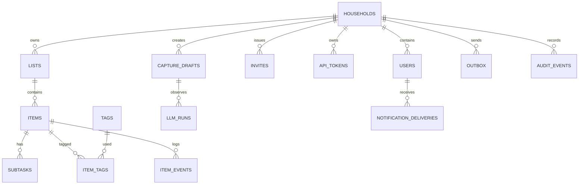

# Модель данных Tasklerq

## 1. Принципы

- **PostgreSQL — source of truth.** Очереди, черновики, уведомления и outbox
  живут в тех же таблицах, что и домен.
- **Один household на пользователя.** `household_id` — tenant-ключ всех
  запросов.
- **Единая таблица `items`.** Задачи, покупки и чек-листы имеют общий жизненный
  цикл; различия — в `lists.kind` и nullable-полях.
- **UUIDv7.** Сортировка по времени, безопасные идентификаторы в URL.
- **Мягкое удаление.** Данные скрываются, но восстанавливаются 30 дней.
- **Версии.** Каждое изменение элемента увеличивает `version`; API требует
  версию для записи.
- **Аудит.** Значимые изменения пишутся в `item_events`; членство и
  безопасность — в `audit_events`.

## 2. ER-диаграмма



## 3. Таблицы

### 3.1 `households`

| Поле | Тип | Ограничения |
| --- | --- | --- |
| `id` | `uuid` | PK, UUIDv7. |
| `name` | `text` | 1..100 символов. |
| `timezone` | `text` | IANA, по умолчанию `Europe/Moscow`. |
| `created_at` | `timestamptz` | NOT NULL. |
| `updated_at` | `timestamptz` | NOT NULL. |
| `deleted_at` | `timestamptz` | NULL, soft delete. |

### 3.2 `users`

| Поле | Тип | Ограничения |
| --- | --- | --- |
| `id` | `uuid` | PK. |
| `household_id` | `uuid` | FK → households, NOT NULL. |
| `telegram_user_id` | `bigint` | NOT NULL; UNIQUE среди `deleted_at IS NULL` (удалённый участник может вернуться по новому приглашению). |
| `telegram_chat_id` | `bigint` | NOT NULL; в приватном чате равен `telegram_user_id` (CLI `user add` задаёт его сам). |
| `display_name` | `text` | 1..64. |
| `username` | `text` | NULL, до 64. |
| `role` | `user_role` | `owner`/`member`. |
| `timezone` | `text` | NULL → используется timezone household. |
| `settings` | `jsonb` | `{"notifications": {...}}`: напоминания, сводка, назначения, lead time (5..1440 мин), время сводки и напоминания о задачах на весь день, тихие часы. Отсутствующие поля принимают значения по умолчанию. |
| `created_at`, `updated_at` | `timestamptz` | NOT NULL. |
| `deleted_at` | `timestamptz` | NULL. |

Один пользователь — один household. При удалении участника строка остаётся с
`deleted_at`, чтобы сохранить авторство задач. В household не более одного
активного `owner` (частичный UNIQUE по `household_id` для `role = 'owner'`);
владение передаётся в одной транзакции. `telegram_user_id` не редактируется.

### 3.3 `lists`

| Поле | Тип | Ограничения |
| --- | --- | --- |
| `id` | `uuid` | PK. |
| `household_id` | `uuid` | FK → households. |
| `kind` | `list_kind` | `tasks`/`shopping`/`checklist`. |
| `name` | `text` | 1..64. |
| `is_default` | `boolean` | Не более одного default на kind. |
| `is_archived` | `boolean` | По умолчанию false. |
| `position` | `integer` | Порядок в меню. |
| `created_at`, `updated_at` | `timestamptz` | NOT NULL. |
| `deleted_at` | `timestamptz` | NULL. |

Инварианты:

- default-список нельзя архивировать или удалять;
- имя уникально в household без учёта регистра среди неудалённых;
- не более 20 списков на household.

### 3.4 `items`

| Поле | Тип | Ограничения |
| --- | --- | --- |
| `id` | `uuid` | PK. |
| `household_id` | `uuid` | FK → households. |
| `list_id` | `uuid` | FK → lists, тот же household. |
| `title` | `text` | 1..200. |
| `notes` | `text` | NULL, до 2000. |
| `status` | `item_status` | `open`/`done`. |
| `priority` | `item_priority` | По умолчанию `normal`. |
| `due_at` | `timestamptz` | NULL; взаимоисключающе с `due_date`. |
| `due_date` | `date` | NULL; all-day. |
| `assignee_user_id` | `uuid` | NULL, FK → users того же household. |
| `created_by_user_id` | `uuid` | NULL для системных источников; FK → users. |
| `source` | `item_source` | `telegram`/`ha_todo`/`ha_voice`/`ha_automation`/`api`/`import`. |
| `capture_id` | `uuid` | NULL, FK → `capture_drafts`; для внешнего capture. |
| `completed_at` | `timestamptz` | NULL. |
| `completed_by_user_id` | `uuid` | NULL. |
| `quantity` | `numeric(7,3)` | NULL или >0..9999.999. |
| `unit` | `text` | NULL или 0..16. |
| `position` | `integer` | Порядок в списке. |
| `version` | `integer` | ≥1, увеличивается при изменении. |
| `recurrence_freq` | `recurrence_freq` | NULL для не-повторяющихся. |
| `recurrence_interval` | `smallint` | 1..365. |
| `recurrence_byweekday` | `smallint[]` | ISO 1..7, только weekly. |
| `recurrence_until` | `date` | NULL. |
| `recurrence_timezone` | `text` | IANA. |
| `recurrence_anchor_date` | `date` | Исходная дата серии. |
| `recurrence_month_rule` | `month_rule` | Только для monthly: `anchor_day` (по умолчанию) или `last_day`. |
| `search_vector` | `tsvector` | Генерируемая колонка. |
| `created_at`, `updated_at` | `timestamptz` | NOT NULL. |
| `deleted_at` | `timestamptz` | NULL. |

Check-ограничения:

```sql
CHECK (due_at IS NULL OR due_date IS NULL)
CHECK (quantity IS NULL OR (quantity > 0 AND quantity <= 9999.999))
CHECK (char_length(unit) <= 16)
CHECK (version >= 1)
CHECK (
  recurrence_freq IS NULL
  OR (recurrence_interval BETWEEN 1 AND 365
      AND recurrence_timezone IS NOT NULL
      AND recurrence_anchor_date IS NOT NULL)
)
CHECK (
  recurrence_freq IS DISTINCT FROM 'weekly'
  OR (recurrence_byweekday IS NOT NULL AND array_length(recurrence_byweekday, 1) > 0)
)
CHECK ((recurrence_freq = 'monthly') = (recurrence_month_rule IS NOT NULL))
```

Дополнительно приложение проверяет, что повторение допустимо только для
`lists.kind = 'tasks'`, а `quantity`/`unit` — только для shopping/checklist.

### 3.5 `subtasks`

| Поле | Тип | Ограничения |
| --- | --- | --- |
| `id` | `uuid` | PK. |
| `item_id` | `uuid` | FK → items, ON DELETE CASCADE. |
| `title` | `text` | 1..200. |
| `status` | `item_status` | `open`/`done`. |
| `position` | `integer` | Порядок. |
| `created_at`, `completed_at` | `timestamptz` | `completed_at` NULL для open. |

Не более 50 подзадач на элемент.

### 3.6 `tags` и `item_tags`

`tags`:

| Поле | Тип | Ограничения |
| --- | --- | --- |
| `id` | `uuid` | PK. |
| `household_id` | `uuid` | FK → households. |
| `name` | `text` | 1..32, unique `(household_id, lower(name))`. |
| `created_at` | `timestamptz` | NOT NULL. |

`item_tags`: `(item_id, tag_id)` PK, оба FK с каскадным удалением. Не более 10
тегов на элемент.

### 3.7 `item_events`

| Поле | Тип | Назначение |
| --- | --- | --- |
| `id` | `uuid` | PK. |
| `household_id` | `uuid` | Tenant. |
| `item_id` | `uuid` | FK → items. |
| `actor_user_id` | `uuid` | NULL для системы/HA/голоса. |
| `actor_type` | `actor_type` | `user`/`system`/`home_assistant`/`voice`. |
| `event_type` | `event_type` | Тип события. |
| `payload` | `jsonb` | До/после, прежний срок, исполнитель. |
| `undo_of` | `uuid` | NULL; ссылка на отменяемое событие. |
| `created_at` | `timestamptz` | NOT NULL. |

Типы событий: `created`, `updated`, `completed`, `reopened`, `deleted`,
`restored`, `assigned`, `unassigned`, `recurrence_changed`,
`subtask_completed`, `subtask_reopened`.

### 3.8 `invites`

| Поле | Тип | Ограничения |
| --- | --- | --- |
| `id` | `uuid` | PK. |
| `household_id` | `uuid` | FK. |
| `code_hash` | `text` | UNIQUE, SHA-256 кода. |
| `role` | `user_role` | `member`. |
| `created_by_user_id` | `uuid` | FK. |
| `expires_at` | `timestamptz` | NOW() + 72h. |
| `used_by_user_id` | `uuid` | NULL. |
| `used_at` | `timestamptz` | NULL. |
| `revoked_at` | `timestamptz` | NULL. |
| `created_at` | `timestamptz` | NOT NULL. |

Не более 5 активных приглашений на household.

### 3.9 `api_tokens`

| Поле | Тип | Ограничения |
| --- | --- | --- |
| `id` | `uuid` | PK. |
| `household_id` | `uuid` | FK. |
| `name` | `text` | 1..64. |
| `token_hash` | `text` | UNIQUE, SHA-256. |
| `prefix` | `text` | Первые символы для отображения. |
| `scopes` | `text[]` | `ha:read`, `ha:write`. |
| `created_by_user_id` | `uuid` | NULL для CLI. |
| `expires_at` | `timestamptz` | NULL. |
| `last_used_at` | `timestamptz` | NULL. |
| `revoked_at` | `timestamptz` | NULL. |
| `created_at` | `timestamptz` | NOT NULL. |

### 3.10 Очереди и состояние Telegram

`telegram_updates`:

| Поле | Тип | Назначение |
| --- | --- | --- |
| `update_id` | `bigint` | PK. |
| `chat_id` | `bigint` | Чат. |
| `user_id` | `bigint` | Пользователь. |
| `payload` | `jsonb` | Полный Update. |
| `status` | `update_status` | `pending`/`processing`/`processed`/`failed`/`dead`. |
| `attempts` | `integer` | По умолчанию 0. |
| `available_at` | `timestamptz` | Время следующей попытки. |
| `last_error` | `text` | Код/краткое описание. |
| `received_at`, `processed_at` | `timestamptz` | Время. |

`telegram_views`: `id`, `chat_id`, `message_id`, `view_key`, `state jsonb`,
`updated_at`; UNIQUE `(chat_id, message_id)`.

`conversation_states`: `id`, `user_id`, `chat_id`, `state`, `payload jsonb`,
`expires_at`, `updated_at`; UNIQUE `(user_id, chat_id)`.

`callback_tokens`: `token_hash` PK, `household_id`, `user_id`, `action`,
`payload jsonb`, `resource_version`, `expires_at`, `consumed_at`.

### 3.11 Capture и LLM

`capture_drafts`:

| Поле | Тип | Назначение |
| --- | --- | --- |
| `id` | `uuid` | PK. |
| `household_id`, `user_id`, `chat_id` | | Владелец; `user_id`/`chat_id` NULL для внешнего capture. |
| `source` | `capture_source` | `telegram`/`ha_voice`/`ha_automation`/`api`/`shortcut`. |
| `mode` | `capture_mode` | `auto`/`draft`. |
| `idempotency_key` | `text` | NULL; UNIQUE `(household_id, source, idempotency_key)`. Резервируется до вызова LLM: параллельный повтор получает `409`. |
| `request_hash` | `text` | SHA-256 тела запроса; тот же ключ с другим хешем — `422`. |
| `raw_text` | `text` | Исходный текст, до 2000. |
| `parsed` | `jsonb` | Валидированная структура. |
| `status` | `draft_status` | `pending`/`applied`/`cancelled`/`expired`/`rejected`. |
| `fallback` | `boolean` | TRUE, если создано из исходного текста без LLM. |
| `prompt_version` | `text` | Например, `capture-v1`. |
| `telegram_message_id` | `bigint` | NULL. |
| `created_at`, `expires_at`, `applied_at` | `timestamptz` | `expires_at` — TTL подтверждения 15 минут; retention `raw_text` — 30 дней. |

`llm_runs`: `id`, `household_id`, `user_id`, `draft_id`, `provider`, `model`,
`prompt_version`, `status`, `latency_ms`, `input_tokens`, `output_tokens`,
`error_code`, `created_at`. Исходный текст не хранится.

### 3.12 Outbox и уведомления

`outbox`: `id`, `household_id`, `chat_id`, `kind`, `payload jsonb`, `status`,
`attempts`, `next_attempt_at`, `telegram_message_id`, `last_error`, `created_at`,
`sent_at`.

`notification_deliveries`: `id`, `household_id`, `user_id`, `item_id` (NULL для
сводки), `occurrence_key`, `kind`, `status`, `scheduled_at`, `sent_at`,
`created_at`; UNIQUE `(user_id, item_id, occurrence_key, kind)`. Для сводок
`item_id` равен NULL, поэтому уникальность обеспечивается
`UNIQUE NULLS NOT DISTINCT` (PostgreSQL 15+) или частичным индексом.

### 3.13 `audit_events`

`id`, `household_id` (NULL для системных), `actor_user_id`, `actor_type`
(источник: `user`/`system`/`home_assistant`/`voice`), `event_type`, `payload
jsonb`, `created_at`. Типы: `household_created`, `member_joined`,
`member_left`, `member_removed`, `role_changed`, `invite_created`,
`invite_used`, `invite_revoked`, `token_created`, `token_revoked`,
`auth_failed`, `rate_limited`, `household_deleted`.

Раздел «Журнал» владельца показывает события членства
(`household_created`, `member_*`, `role_changed`, `invite_*`,
`household_deleted`) за 90 дней; события токенов и безопасности остаются в
аудите. Payload собирается из явных полей и не содержит кодов приглашений,
токенов и хешей; имена хранятся снимком на момент события. Участники и
household, созданные через `tasklerq admin`, попадают в журнал от имени
системного актора (`actor_type = system`).

## 4. Перечисления

| Тип | Значения |
| --- | --- |
| `user_role` | `owner`, `member` |
| `list_kind` | `tasks`, `shopping`, `checklist` |
| `item_status` | `open`, `done` |
| `item_priority` | `low`, `normal`, `high`, `urgent` |
| `recurrence_freq` | `daily`, `weekly`, `monthly`, `yearly` |
| `month_rule` | `anchor_day`, `last_day` |
| `actor_type` | `user`, `system`, `home_assistant`, `voice` |
| `event_type` | `created`, `updated`, `completed`, `reopened`, `deleted`, `restored`, `assigned`, `unassigned`, `recurrence_changed`, `subtask_completed`, `subtask_reopened` |
| `update_status` | `pending`, `processing`, `processed`, `failed`, `dead` |
| `draft_status` | `pending`, `applied`, `cancelled`, `expired`, `rejected` |
| `capture_source` | `telegram`, `ha_voice`, `ha_automation`, `api`, `shortcut` |
| `capture_mode` | `auto`, `draft` |
| `item_source` | `telegram`, `ha_todo`, `ha_voice`, `ha_automation`, `api`, `import` |
| `outbox_status` | `pending`, `sending`, `sent`, `failed`, `dead` |
| `notification_kind` | `reminder`, `digest`, `assignment`, `snooze` |

## 5. Инварианты

1. Элемент и его список принадлежат одному household.
2. `due_at` и `due_date` не могут быть заполнены одновременно.
3. Повторение допустимо только для `tasks`; `weekly` требует непустой
   `byweekday`; `interval` 1..365; `until` не раньше якоря и не позже +5 лет.
4. `quantity` >0..9999.999; `unit` до 16 символов.
5. `title` 1..200; `notes` до 2000; тегов ≤10; подзадач ≤50.
6. Исполнитель — участник того же household; автор-пользователь, если указан,
   тоже участник. Для системного источника `created_by_user_id` может быть NULL.
7. В household ровно один default-список `tasks` и один default-список
   `shopping`; их нельзя удалить/архивировать.
8. `done` требует `completed_at` и `completed_by_user_id`; `open` не требует.
9. `version` монотонно растёт; конфликт версий не применяется.
10. Удалённые элементы не видны в API, поиске, календаре и HA.
11. Пользователь состоит не более чем в одном household.
12. Тег уникален в household без учёта регистра.
13. Приглашение одноразовое; код хранится только как хеш.
14. API-токен хранится только как хеш; scopes обязательны.
15. Ключ уведомления уникален; повтор не создаёт дубль.
16. Внешний capture с `idempotency_key` уникален в рамках
    `(household_id, source)`; повтор возвращает исходный результат.
17. Все элементы одного capture создаются и отменяются вместе; частичного
    применения нет.
18. `source` элемента неизменяем; `capture_id` очищается при retention, элемент
    остаётся.
19. `capture_drafts.source=shortcut` создаёт элементы с `items.source=api`;
    `ha_voice` и `ha_automation` сохраняются как есть.

## 6. Состояния

### Элемент

```text
           complete                 reopen
  open ───────────────▶ done ───────────────▶ open
    │                     │
    │ delete              │ delete
    ▼                     ▼
 deleted ◀────────────── deleted
    │ restore             │ restore
    └────────▶ open       └────────▶ done
```

Мягкое удаление сохраняет прежний статус; восстановление возвращает его.
Повторяющаяся задача после завершения остаётся `open` с новым сроком, если
следующее вхождение существует; иначе становится `done`.

### Черновик

```text
pending ──confirm──▶ applied
   │
   ├──cancel──▶ cancelled
   └──ttl─────▶ expired
```

`applied`, `cancelled`, `expired` — терминальные.

### Очередь обновлений

```text
pending ──claim──▶ processing ──ok──▶ processed
   ▲                   │
   └──retry────────────┘
                       └──max attempts──▶ dead
```

### Outbox

```text
pending ──claim──▶ sending ──ok──▶ sent
   ▲                   │
   └──retry────────────┘
                       └──max attempts──▶ dead
```

### Приглашение

```text
active ──use──▶ used
   ├──revoke──▶ revoked
   └──ttl─────▶ expired
```

## 7. Повторения

### Правило

```text
freq:      daily | weekly | monthly | yearly
interval:  1..365
weekdays:  ISO 1..7, только weekly
month_rule: anchor_day | last_day, только monthly
until:     date | null
timezone:  IANA
anchor:    date — исходная дата серии
```

Текущий срок (`due_at`/`due_date`) — ближайшее вхождение. Следующее вхождение
вычисляется от якоря, а не от текущего срока. Если срок при создании не указан
(например, LLM вернула только правило), якорем и первым сроком становится
ближайшее по правилу вхождение не раньше сегодняшнего дня.

### Алгоритм

1. Взять локальную дату текущего вхождения в `recurrence_timezone`.
2. Для `daily`: прибавить `interval` дней.
3. Для `weekly`: перебрать дни после текущего; найти следующий день из
   `weekdays`; при переходе через неделю прибавить `interval` недель.
4. Для `monthly`: прибавить `interval` месяцев. При `anchor_day` сохранить день
   из якоря; если дня нет — перейти к следующему месяцу (пропуск). При
   `last_day` взять последний день получившегося месяца. Срок новой серии с
   `last_day` — последний день месяца указанной даты.
5. Для `yearly`: прибавить `interval` лет; сохранить месяц/день якоря; если
   даты нет (29 февраля) — пропустить год.
6. Если `until` задан и следующая дата позже — серия завершена.
7. Повторять шаги 2–6, пока вхождение не окажется строго позже момента
   завершения (просроченная серия не порождает вхождений в прошлом).
8. Сохранить новый срок; для timed-задачи — в UTC с учётом timezone.

### Примеры

| Правило | Якорь | Вхождения |
| --- | --- | --- |
| weekly, Tue/Thu, interval 1 | 2026-11-03 (Tue) | 3, 5, 10, 12, 17, 19 ноября… |
| monthly, 31, interval 1 | 2026-01-31 | 31 янв, 31 мар, 31 мая, 31 июл, 31 авг, 31 окт, 31 дек… |
| monthly, `last_day`, interval 1 | 2026-01-15 (срок → 31 янв) | 31 янв, 28 фев, 31 мар, 30 апр, 31 мая… |
| yearly, 29 Feb, interval 1 | 2024-02-29 | 2024, 2028, 2032… |
| daily, interval 3 | 2026-11-01 | 1, 4, 7, 10 ноября… |
| weekly, Mon, until 2026-12-31 | 2026-11-02 | последнее вхождение 28 декабря |

### Завершение и отмена

- Завершение фиксирует вхождение в `item_events` с прежним сроком.
- Если следующее вхождение есть, задача остаётся `open` с новым сроком.
- Если серия закончилась, задача становится `done`.
- Повторное открытие восстанавливает прежний срок из последнего события.
- Редактирование правила меняет всю серию; завершённые вхождения в журнале не
  переписываются.
- Исключения и редактирование отдельного вхождения в MVP отсутствуют.

## 8. Часовые пояса и DST

- Пользователь вводит срок в своём часовом поясе; API принимает ISO 8601 с
  offset или timezone.
- `due_at` хранится в UTC; `due_date` — календарная дата.
- Отображение — в timezone пользователя, затем household.
- Повторения считаются по локальному настенному времени: 09:00 остаётся 09:00
  при смене DST.
- Несуществующее локальное время (весной) сдвигается вперёд до первого
  существующего часа.
- Неоднозначное локальное время (осенью) трактуется как первое вхождение
  (летнее смещение).
- Вседневная задача не меняет дату при смене смещения.

Пример: `Europe/Berlin`, 2026-03-29, 02:30 не существует → 03:00.
`Europe/Berlin`, 2026-10-25, 02:30 существует дважды → выбирается первое
(02:30 CEST).

## 9. Поиск

- `search_vector` — генерируемая колонка из `title` и `notes` с конфигурацией
  `simple`.
- GIN-индекс по `search_vector`; `pg_trgm` GIN по `title` для подстрок.
- Теги и подзадачи участвуют в поиске через join.
- Фильтры: `status`, `list_id`, `assignee_user_id`, `tag`, `due_from`,
  `due_to`. Срок фильтруется полуоткрытым интервалом `[due_from, due_to)`.
  Дата `YYYY-MM-DD` берётся в часовом поясе household (`due_to` — полночь
  следующего дня), значение RFC 3339 — точный момент.
- Сортировка: релевантность, затем срок, затем `created_at`.
- Курсор: `(rank, due_at, id)` в base64; стабилен при вставках.
- Удалённые, архивные и (по умолчанию) выполненные исключаются.
- Русская морфология: `simple` не делает стемминг; `pg_trgm` компенсирует
  подстроки. При недоступности расширения — `ILIKE`.

## 10. Мягкое удаление и retention

| Данные | Срок | Механизм |
| --- | --- | --- |
| `items.deleted_at` | 30 дней | purge job. |
| `lists.deleted_at` | 30 дней | purge job + каскад. |
| `households.deleted_at` | 30 дней | purge job. |
| `telegram_updates` | 7 дней | retention job. |
| `capture_drafts` | 30 дней | retention job. |
| `llm_runs` | 90 дней | retention job. |
| `item_events` | 365 дней | retention job. |
| `outbox` sent | 30 дней | retention job. |
| `audit_events` | 365 дней | retention job. |

Purge удаляет связанные подзадачи, теги, события и черновики. Восстановление
после истечения срока невозможно.

## 11. Транзакции

| Операция | Границы |
| --- | --- |
| Применение черновика | Все элементы + события + outbox. |
| Завершение задачи | Статус + событие + следующий срок. |
| Очистка выполненных | Все выбранные элементы + события. |
| Удаление участника | Назначения + приглашения + доступ. |
| Подтверждение приглашения | Использование кода + создание пользователя. |
| Создание household | Household + owner + два списка. |
| Отправка уведомления | `notification_deliveries` + outbox. |

## 12. Индексы

```sql
-- items
CREATE INDEX items_household_list_status_idx
  ON items (household_id, list_id, status) WHERE deleted_at IS NULL;
CREATE INDEX items_household_assignee_idx
  ON items (household_id, assignee_user_id, status) WHERE deleted_at IS NULL;
CREATE INDEX items_due_idx
  ON items (household_id, due_at) WHERE deleted_at IS NULL AND due_at IS NOT NULL;
CREATE INDEX items_due_date_idx
  ON items (household_id, due_date) WHERE deleted_at IS NULL AND due_date IS NOT NULL;
CREATE INDEX items_search_idx ON items USING gin (search_vector);
CREATE INDEX items_capture_idx
  ON items (capture_id) WHERE capture_id IS NOT NULL;

-- captures
CREATE UNIQUE INDEX capture_idempotency_idx
  ON capture_drafts (household_id, source, idempotency_key)
  WHERE idempotency_key IS NOT NULL;
CREATE INDEX capture_source_applied_idx
  ON capture_drafts (household_id, source, applied_at DESC);

-- tags
CREATE UNIQUE INDEX tags_household_lower_name_idx
  ON tags (household_id, lower(name));

-- queues
CREATE INDEX telegram_updates_ready_idx
  ON telegram_updates (available_at) WHERE status = 'pending';
CREATE INDEX outbox_ready_idx
  ON outbox (next_attempt_at) WHERE status = 'pending';
CREATE UNIQUE INDEX notification_delivery_key_idx
  ON notification_deliveries (user_id, item_id, occurrence_key, kind);

-- events
CREATE INDEX item_events_item_created_idx
  ON item_events (item_id, created_at DESC);
```

## 13. Миграции

- Инструмент: `sqlx migrate`.
- Имена: `0001_init.sql`, `0002_add_...sql`.
- Применяются при старте под `pg_advisory_lock` или командой `tasklerq migrate`.
- Схема expand/contract: добавление → двойная запись/чтение → удаление в
  следующем релизе.
- Откат приложения — на предыдущий образ; схема остаётся совместимой.
- Разрушительные изменения не выполняются в одном релизе с кодом, который
  перестаёт использовать старые поля.
- Перед обновлением — backup.

## 14. Открытые вопросы

- Нужен ли `pg_trgm` на сервере пользователя; если нет — fallback `ILIKE`.
- Версия PostgreSQL (минимум 15) и доступность расширений.
- Нужно ли хранить `raw_text` черновика 30 дней или сократить до 7.
- Нужен ли экспорт данных в JSON уже в MVP (CLI предусмотрен).
